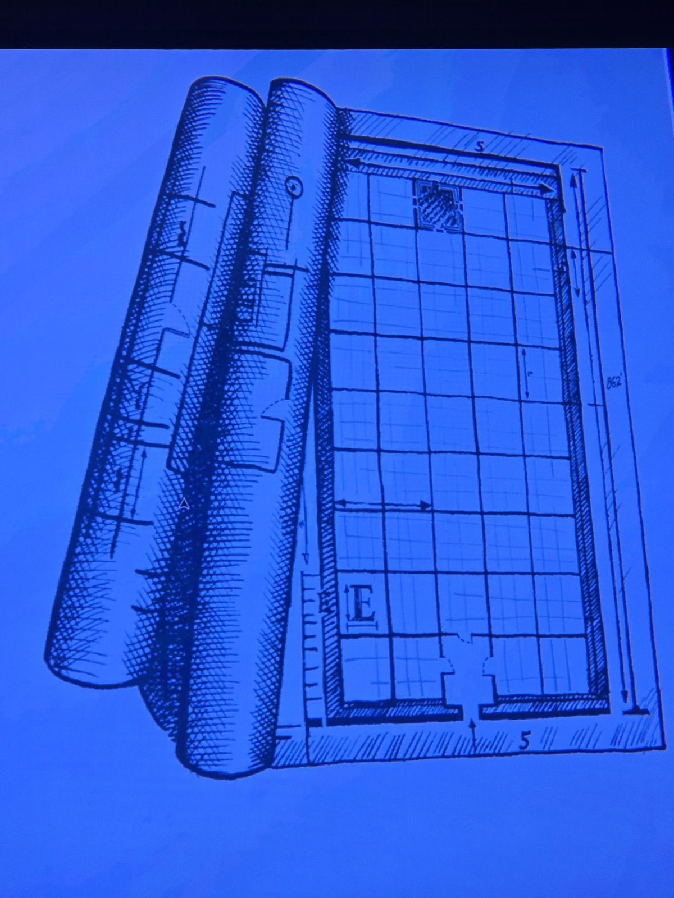

Свёрнутый чертёж дома: сетка 5×9, вход снизу по центру. Одна клетка **в верхнем ряду заштрихована**, внизу слева отмечена буква **«E»**.
*Заметка: возможно, подсказка, где что-то лежит/куда ставить комнату. Комната не записана.*

## Photos / Фото

