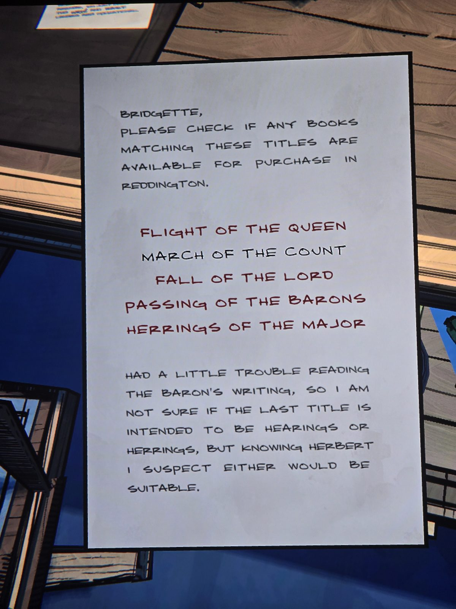

Бриджит, проверь, продаются ли в Реддингтоне книги:
Flight of the Queen / **March of the Count** (написано чёрным, остальные красным) / Fall of the Lord / Passing of the Barons / Herrings (Hearings?) of the Major.
«С трудом разобрала почерк барона… зная Герберта, подойдёт любое».
(Подсказка к сейфу в Office: MARCH = 03.)

## Photos / Фото

