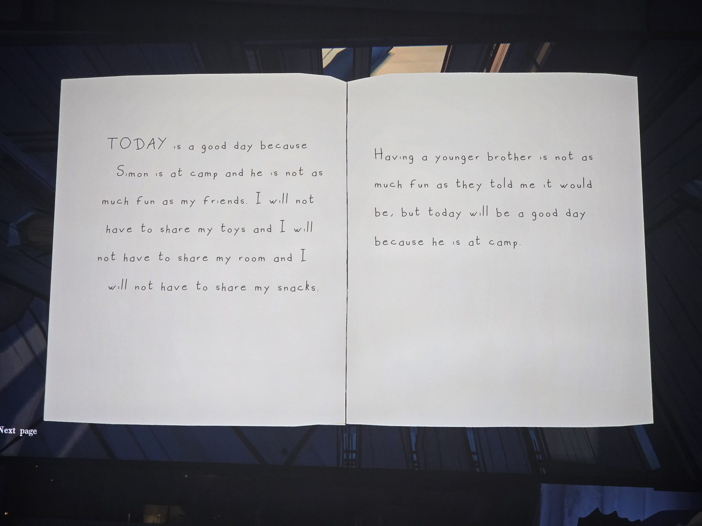
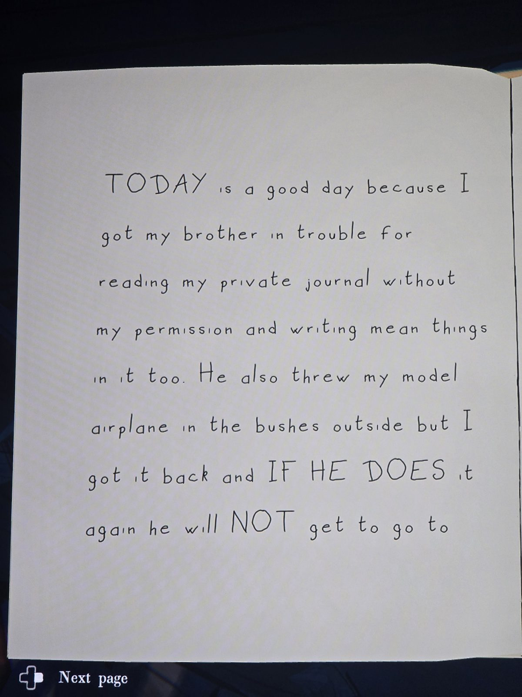
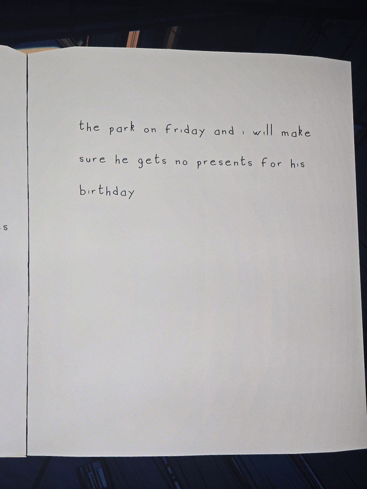
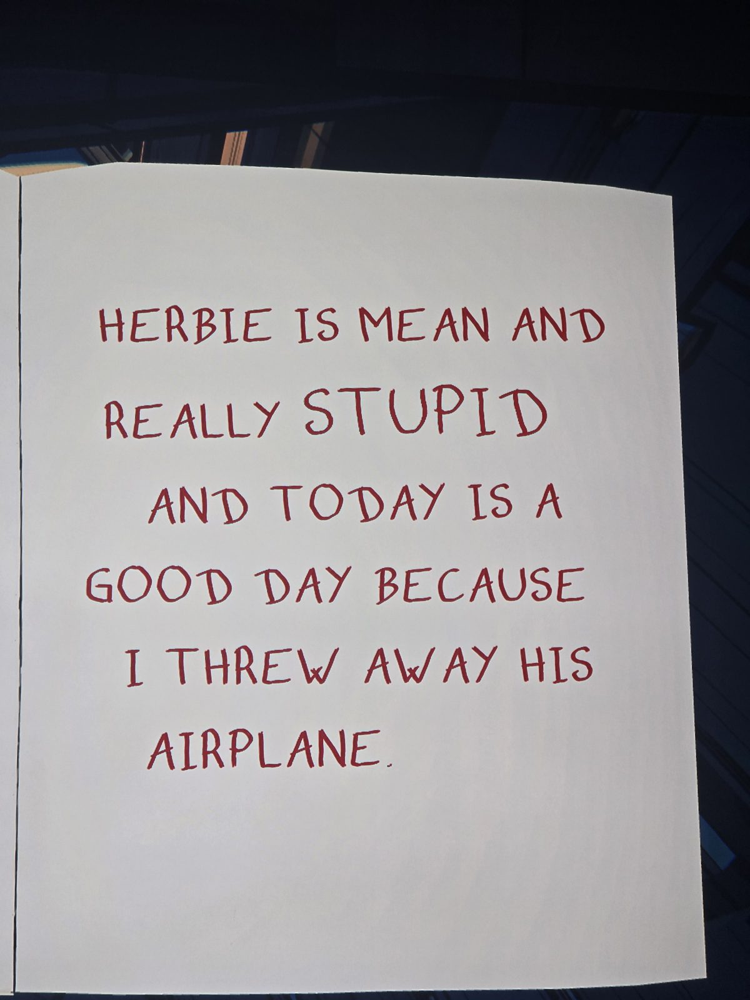
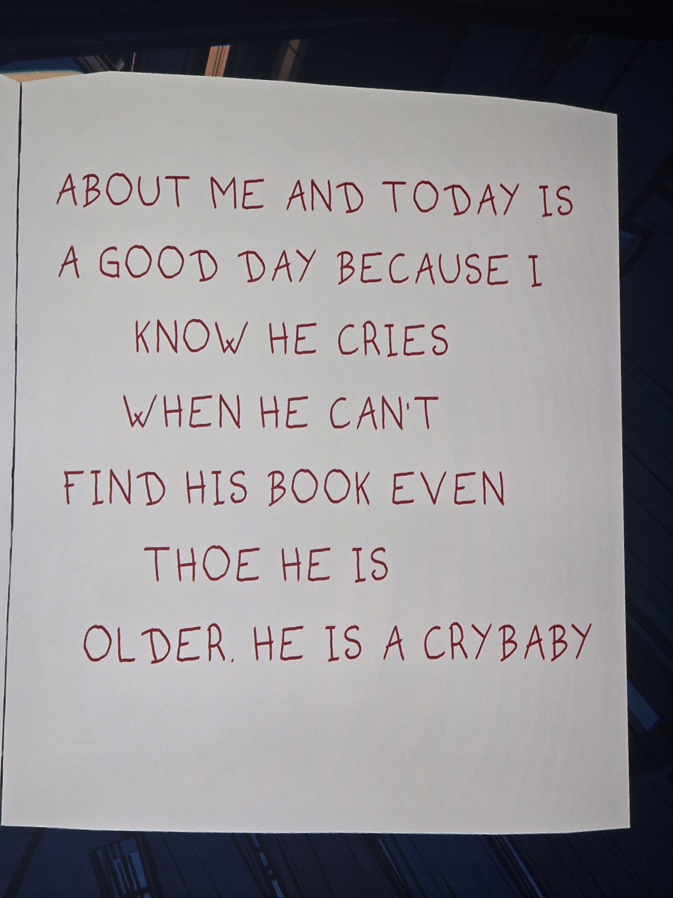
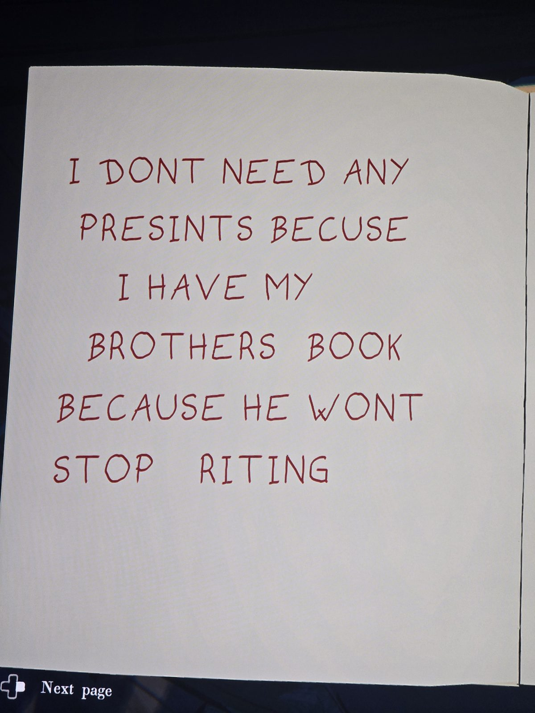
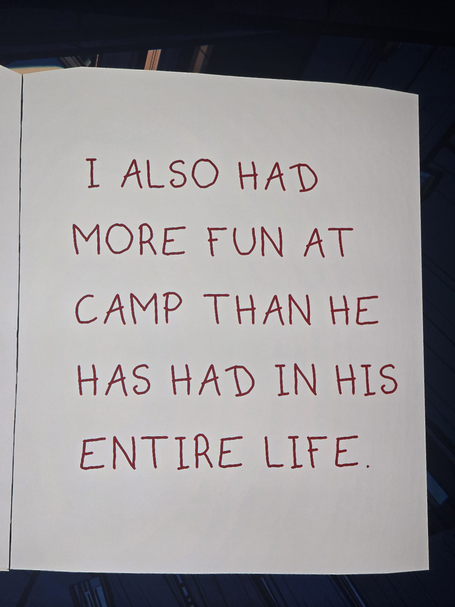
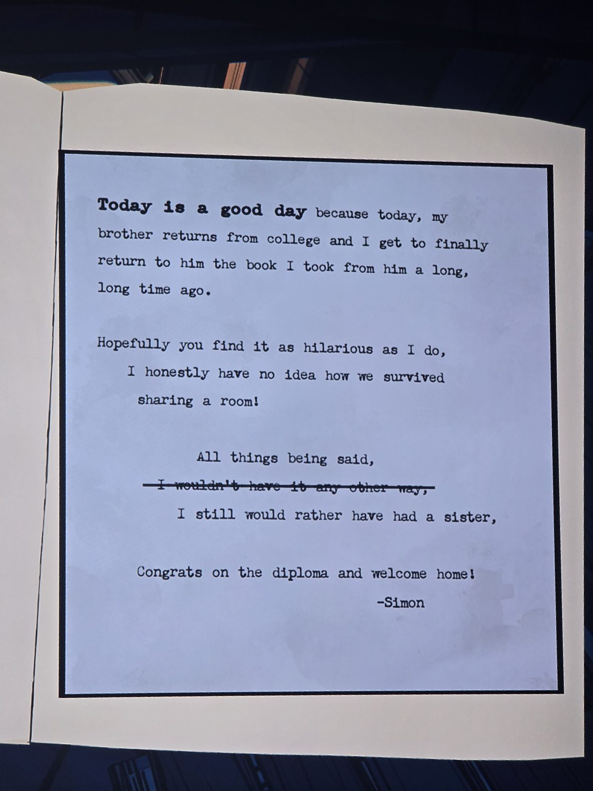

Shared childhood diary of Herbert ("Herbie", neat black handwriting) and his younger brother Simon (red capitals).
Herbert: TODAY is a good day because Simon is at camp and he is not as much fun as my friends. I will not have to share my toys and I will not have to share my room and I will not have to share my snacks. Having a younger brother is not as much fun as they told me it would be, but today will be a good day because he is at camp.
Herbert: TODAY is a good day because I got my brother in trouble for reading my private journal without my permission and writing mean things in it too. He also threw my model airplane in the bushes outside but I got it back and IF HE DOES it again he will NOT get to go to the park on Friday and I will make sure he gets no presents for his birthday.
Simon: HERBIE IS MEAN AND REALLY STUPID AND TODAY IS A GOOD DAY BECAUSE I THREW AWAY HIS AIRPLANE. … ABOUT ME AND TODAY IS A GOOD DAY BECAUSE I KNOW HE CRIES WHEN HE CAN'T FIND HIS BOOK EVEN THOE HE IS OLDER. HE IS A CRYBABY. I DONT NEED ANY PRESINTS BECUSE I HAVE MY BROTHERS BOOK BECAUSE HE WONT STOP RITING. I ALSO HAD MORE FUN AT CAMP THAN HE HAS HAD IN HIS ENTIRE LIFE.
Typed insert (adult Simon): Today is a good day because today, my brother returns from college and I get to finally return to him the book I took from him a long, long time ago. Hopefully you find it as hilarious as I do, I honestly have no idea how we survived sharing a room! All things being said, ~~I wouldn't have it any other way,~~ I still would rather have had a sister. Congrats on the diploma and welcome home! — Simon

## Photos / Фото

