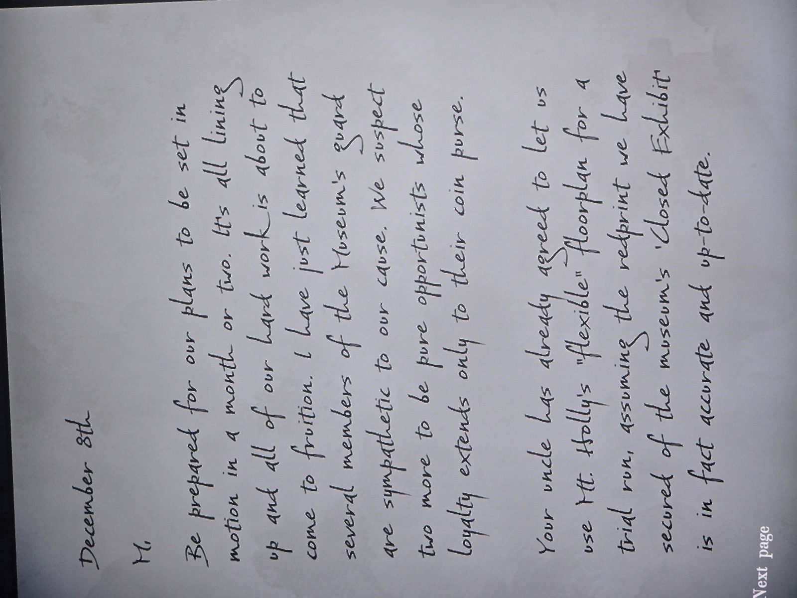
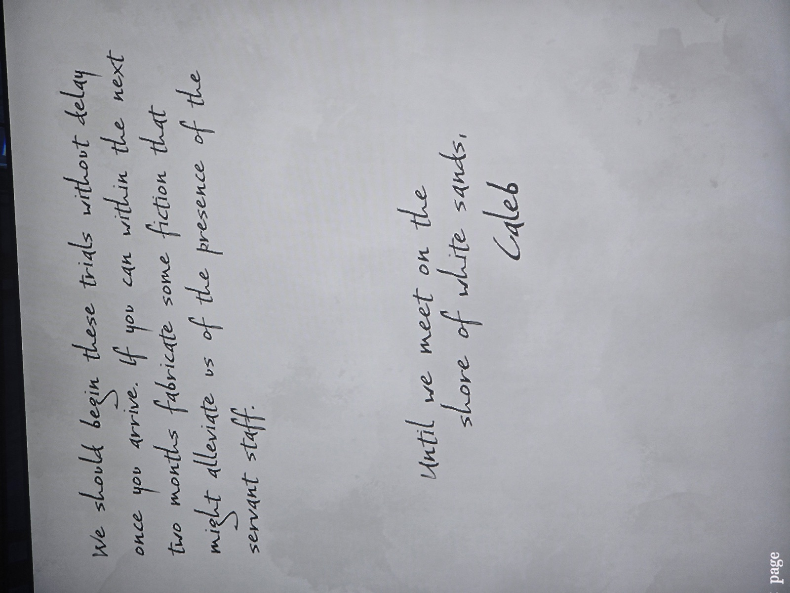
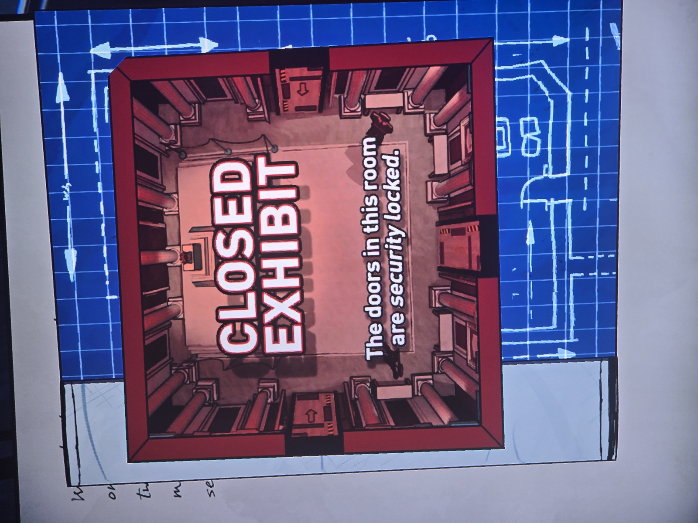

**Письмо Калеба к «M» (Мэри)**, 8 декабря [1986]:
«Будь готова: через месяц-два планы придут в движение. Всё складывается, наша работа вот-вот принесёт плоды. Я узнал, что несколько охранников Музея **сочувствуют нашему делу**; ещё двое, подозреваем, — чистые оппортунисты, верные только кошельку.
**Твой дядя уже согласился** дать нам использовать «гибкую» планировку Маунт-Холли для **пробного прогона** — если «красный чертёж» (redprint) **Closed Exhibit** музея, который мы добыли, точен и актуален.
Начнём испытания сразу, как приедешь. Если сможешь за два месяца придумать какую-нибудь историю, чтобы избавиться от присутствия прислуги…
До встречи на берегу белых песков, Калеб»
Приложен «redprint»: карточка комнаты **CLOSED EXHIBIT** — «двери этой комнаты под охранной блокировкой».

*Заметка: Калеб = Калеб Мэннинг (RLCF, автор History of Orindia). **Герберт знал и помогал** — разрешил отрепетировать ограбление в доме. Отсюда комната Closed Exhibit в поместье и отключение камер 10.02.87. Комната находки не записана.*

## Photos / Фото

