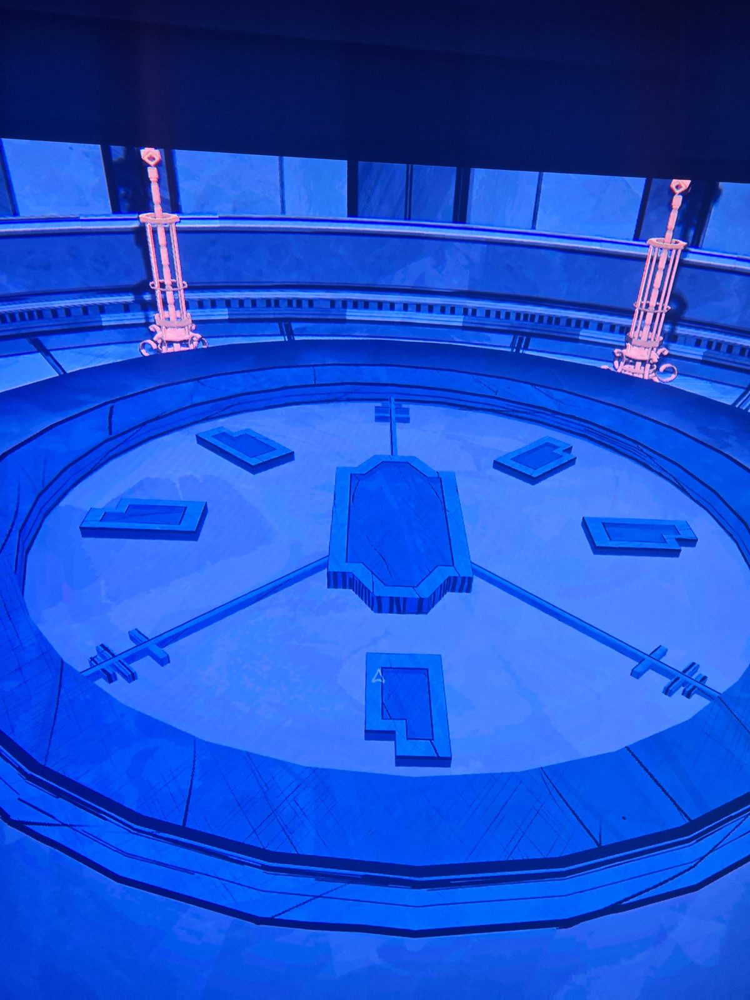

Large clock-face floor: central plinth with hands pointing to 12, 4 and 8; raised slabs at the other hour positions. Pink candelabra-style pillars around the edge. (Seen with a piece of the Underground Map; room caption "Abandon…")

## Photos / Фото

