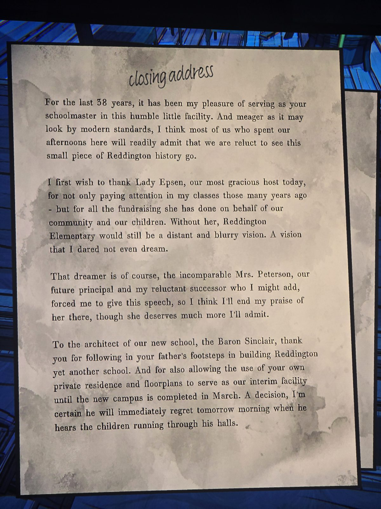
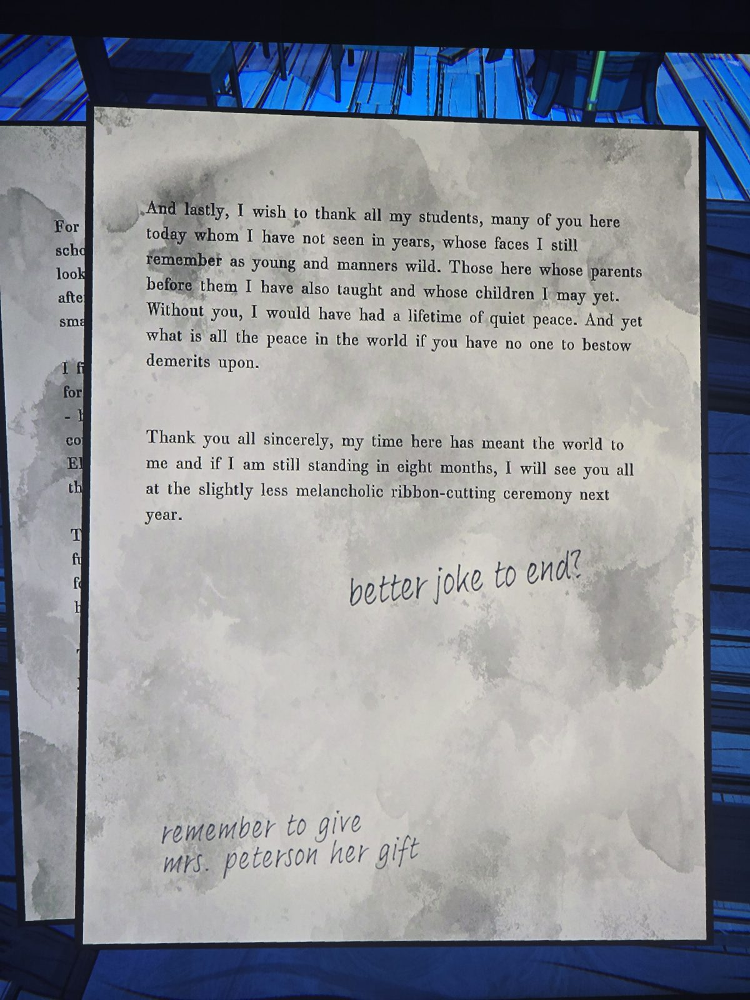

closing address
For the last 58 years, it has been my pleasure of serving as your schoolmaster in this humble little facility…
I first wish to thank Lady Epsen, our most gracious host today, … Without her, Reddington Elementary would still be a distant and blurry vision.
That dreamer is of course, the incomparable Mrs. Peterson, our future principal and my reluctant successor…
To the architect of our new school, the Baron Sinclair, thank you for following in your father's footsteps in building Reddington yet another school. And for also allowing the use of your own private residence and floorplans to serve as our interim facility until the new campus is completed in March…
And lastly, I wish to thank all my students… Thank you all sincerely, my time here has meant the world to me and if I am still standing in eight months, I will see you all at the slightly less melancholic ribbon-cutting ceremony next year.
Notes: "better joke to end?", "remember to give mrs. peterson her gift".

## Photos / Фото

