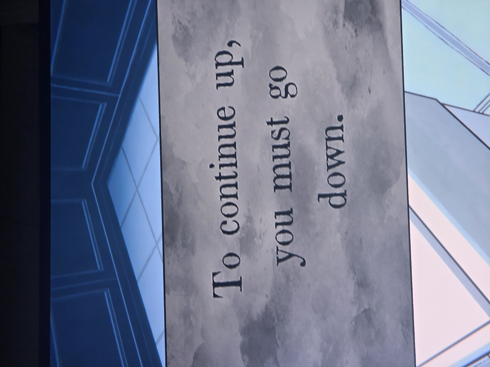

«Чтобы подняться выше, нужно спуститься вниз».
*Заметка: вероятно, про северный рычаг Antechamber — он под землёй (см. puzzles/antechamber-levers и карту подземелья, п. 9). Комната не записана (белая плитка).*

## Photos / Фото

