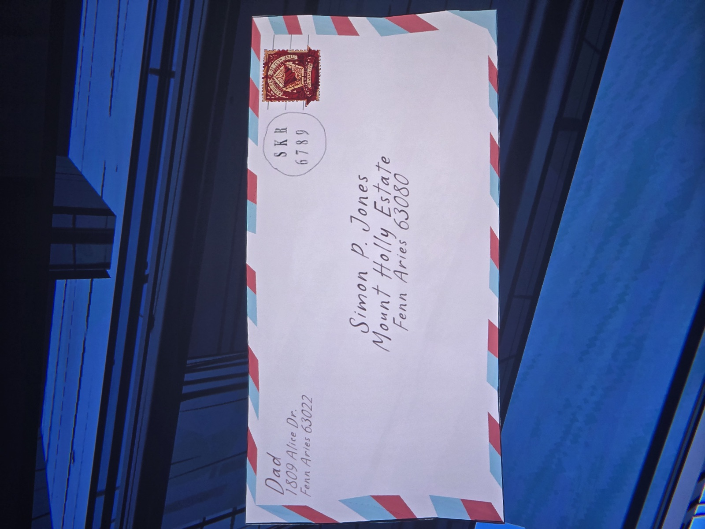
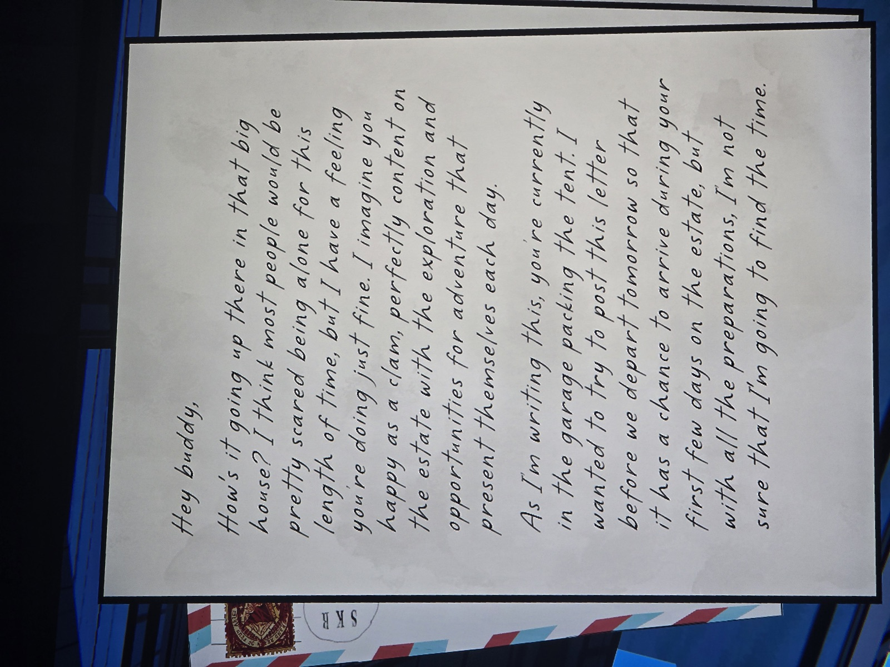
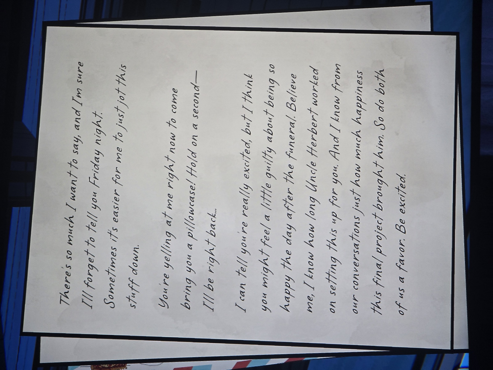
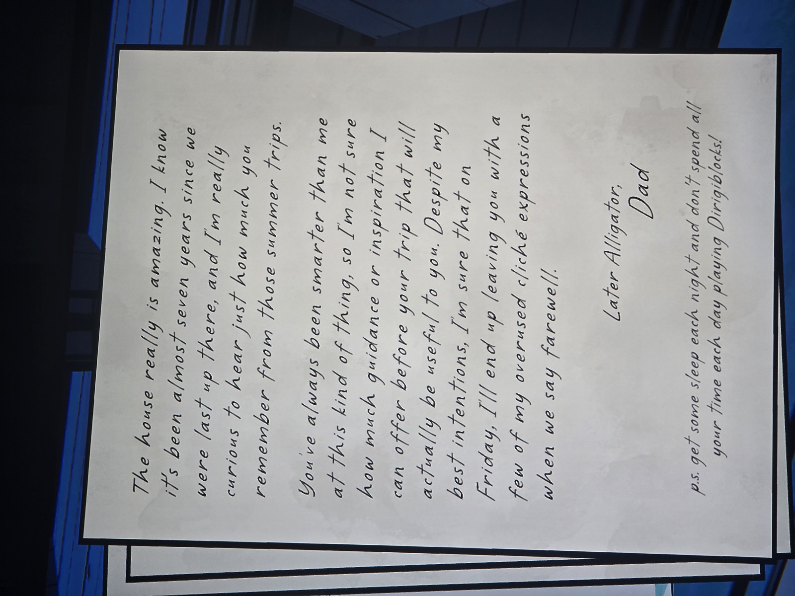

Конверт: от «Папы» (1809 Alice Dr., Fenn Aries 63022) → Саймону П. Джонсу, поместье Маунт-Холли. Штемпель SKR 6789.

Привет, дружище!
Как ты там в большом доме? Большинству было бы страшно столько времени одному, но, думаю, ты справляешься — довольный, как моллюск, исследуешь поместье и каждый день находишь приключения.
Пока я пишу, ты в гараже пакуешь палатку. Хотел отправить письмо до нашего завтрашнего отъезда, чтобы оно пришло в твои первые дни в поместье, но со сборами не уверен, что успею.
Столько хочу сказать — и наверняка забуду в пятницу вечером, проще записать.
(Ты кричишь, чтобы я принёс наволочку! Секунду…)
Ты в восторге, но, кажется, чувствуешь вину, что так счастлив на следующий день после похорон. Я знаю, как долго дядя Герберт всё это для тебя готовил и сколько радости принёс ему этот последний проект. Так что сделай нам обоим одолжение — радуйся.
Дом правда потрясающий. Прошло почти семь лет с тех пор, как мы были там в последний раз; интересно, сколько ты помнишь с тех летних поездок.
Ты всегда был умнее меня в таких вещах, так что не знаю, чем смогу помочь. В пятницу при прощании наверняка оставлю тебе пару своих заезженных фраз.
«До встречи, аллигатор», Папа.
P.S. Высыпайся и не играй целыми днями в Dirigiblocks!

*Заметка: папа — Дэниел (Джонс), муж Мэри. Письмо написано за день до отъезда семьи (в поход с палаткой), день после похорон Герберта. «Почти семь лет» с последней поездки → около 1986, как раз до исчезновения Мэри. Комната, где найдено, не записана.*

## Photos / Фото

