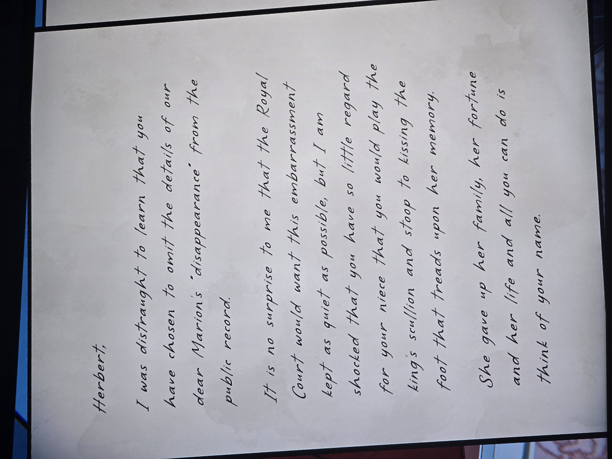
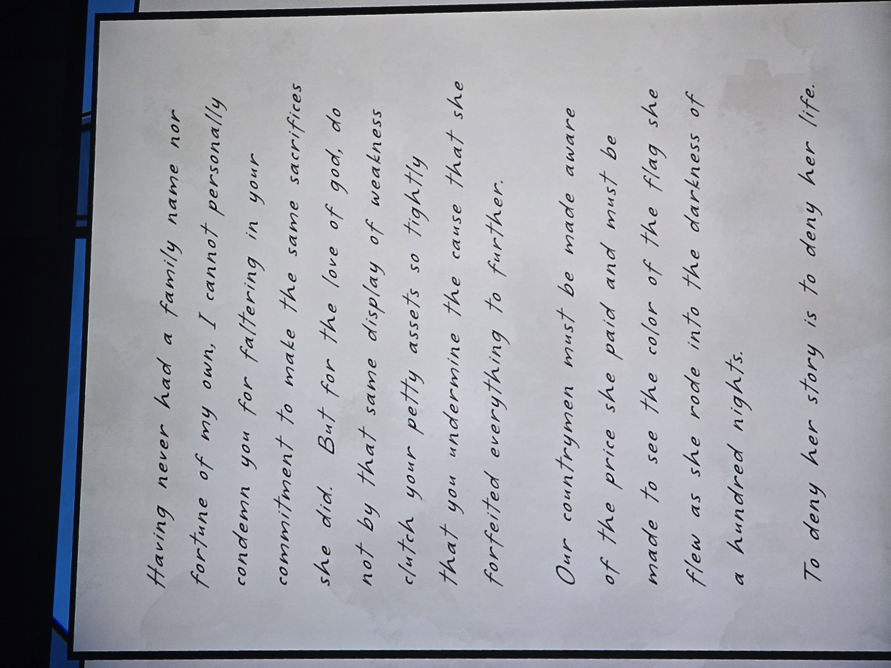
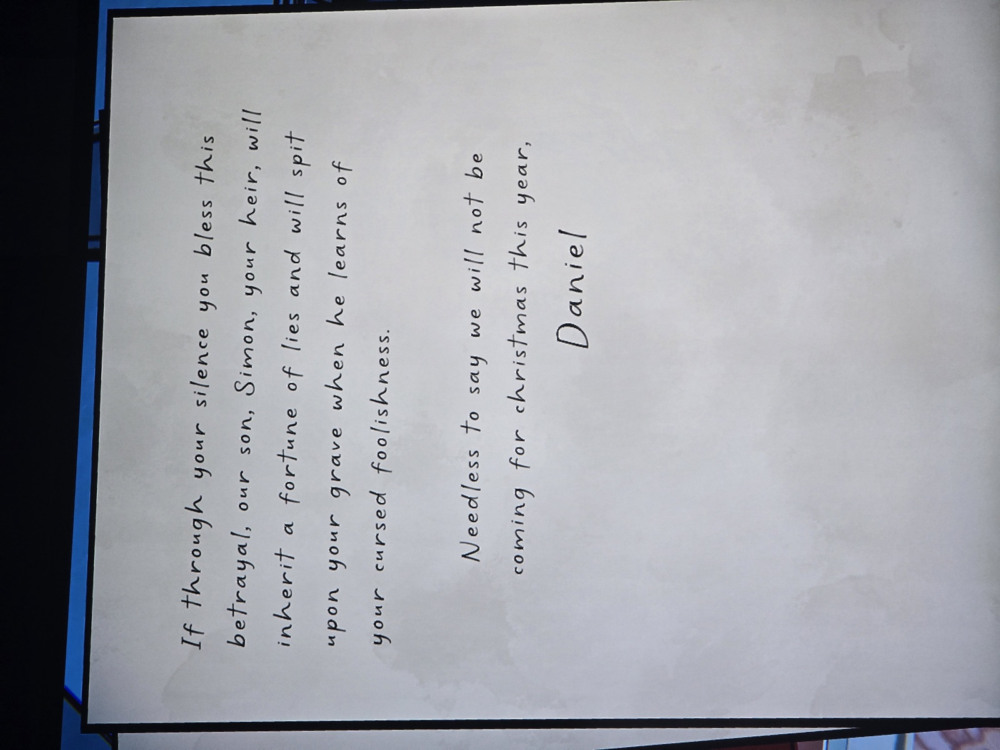

Герберт,
я в отчаянии: ты решил исключить подробности «исчезновения» нашей дорогой Мэрион из публичных записей.
Неудивительно, что Королевский двор хочет замять этот конфуз, но я потрясён, что ты так мало ценишь племянницу, что готов быть королевским поварёнком и целовать ногу, которая топчет её память.
Она отказалась от семьи, состояния и жизни — а ты думаешь только о своём имени.
У меня никогда не было ни родового имени, ни состояния, так что не мне судить тебя за то, что ты не готов к таким же жертвам. Но ради бога, не цепляйся за своё мелкое имущество так, чтобы подорвать **дело, ради которого она пожертвовала всем**.
Соотечественники должны узнать, какую цену она заплатила, и увидеть **цвет флага, под которым она въехала во тьму ста ночей**.
Отрицать её историю — значит отрицать её жизнь.
Если своим молчанием ты благословишь это предательство, наш сын Саймон, твой наследник, унаследует состояние лжи и плюнет на твою могилу, узнав о твоём проклятом безрассудстве.
Разумеется, на Рождество в этом году мы не приедем.
Дэниел

*Заметка: Дэниел — муж Мэри (Мэрион Мариголд), отец героя. Он прямо говорит, что Мэри «отдала жизнь» за повстанческое дело (красный флаг?). «Тьма ста ночей» — возможно, отсылка к «Сто колоколов» / Hundred Bells (где её видели в последний раз). Написано вскоре после исчезновения (1987), до Рождества. Комната не записана.*

## Photos / Фото

