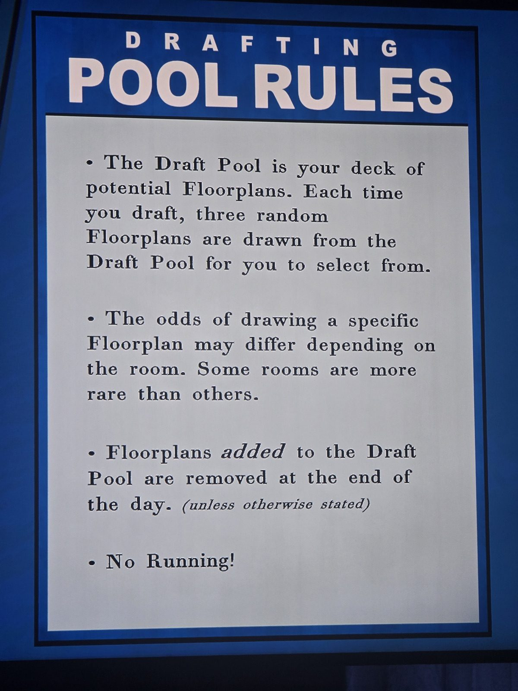

DRAFTING POOL RULES
• The Draft Pool is your deck of potential Floorplans. Each time you draft, three random Floorplans are drawn from the Draft Pool for you to select from.
• The odds of drawing a specific Floorplan may differ depending on the room. Some rooms are more rare than others.
• Floorplans *added* to the Draft Pool are removed at the end of the day. (unless otherwise stated)
• No Running!

## Photos / Фото

