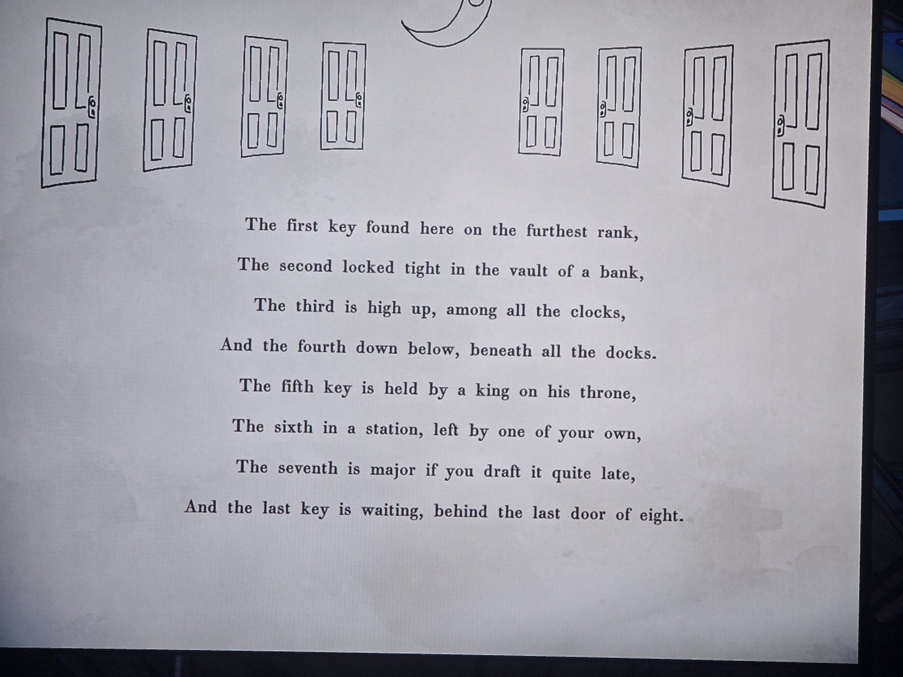

Стихотворение (над ним 8 дверей и полумесяц):
Первый ключ найдёшь здесь, на самом дальнем ряду,
Второй заперт крепко в банковском сейфе,
Третий — высоко, среди всех часов,
Четвёртый — внизу, под всеми причалами.
Пятый держит король на своём троне,
Шестой — на станции, оставлен кем-то из твоих,
Седьмой — «главный» (major), если вытянешь его поздно,
А последний ждёт за последней из восьми дверей.
*Заметка: 8 ключей → 8 дверей (вероятно, комнаты с 8 запертыми дверями / Room 8?). Ср. ложную зелёную карточку «12 главных ключей». Не решено. Комната не записана.*

## Photos / Фото

