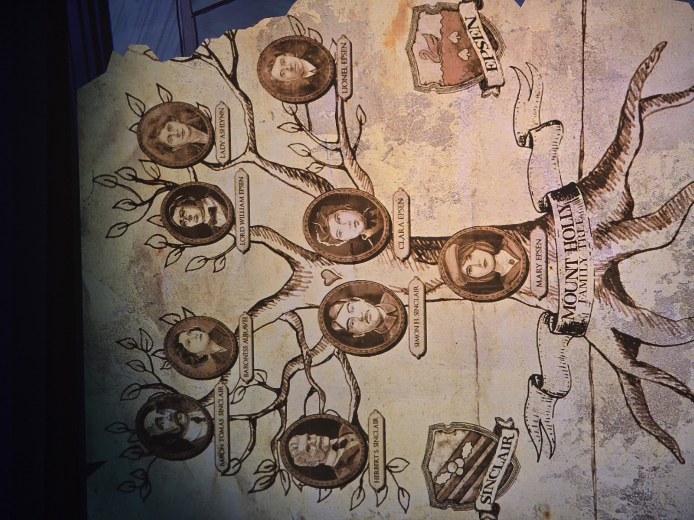
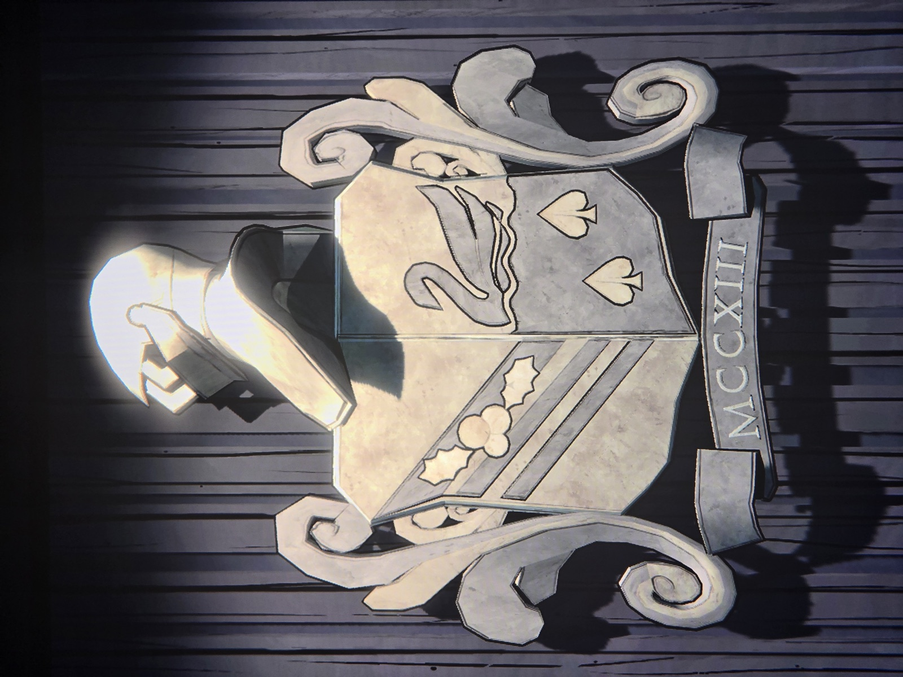

Генеалогическое древо Маунт-Холли:
- **Барон Томас Синклер** + **баронесса Ауравей** → **Герберт С. Синклер**, **Саймон Х. Синклер**
- **Лорд Уильям Эпсен** + **леди Эшлинн** → **Клара Эпсен**, **Лайонел Эпсен**
- Саймон Х. Синклер + Клара Эпсен → **Мэри Эпсен** (позже Мэри Мэтью Джонс / Мэрион Мариголд)

Гербы: **Синклер** — диагональные полосы с остролистом; **Эпсен** — лебедь на воде и две пики. Объединённый герб с датой MCCXIII (1213) — см. фото 02.

*Заметка: Лайонел Эпсен — брат Клары; вероятно, отец Кортни (автор красного письма VII). Комната не записана.*

## Photos / Фото

