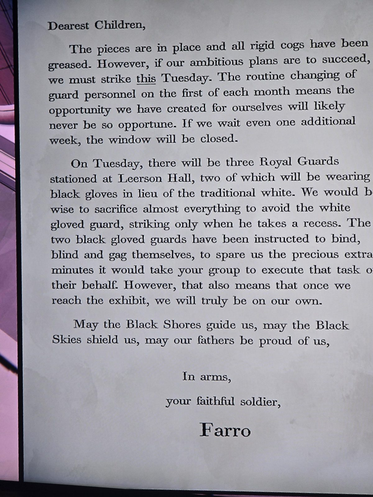

Дорогие дети,
все фигуры на местах, шестерёнки смазаны. Действовать нужно **в этот вторник**: плановая смена караула **1-го числа** даёт уникальный шанс, через неделю окно закроется.
Во вторник в **зале Лирсона** будут трое королевских гвардейцев, двое — в **чёрных перчатках** вместо белых (подкуплены: сами себя свяжут). Стражника в **белых** перчатках избегать любой ценой, действовать, когда он уйдёт на перерыв. У экспозиции мы будем одни.
Пусть Чёрные Берега ведут нас, Чёрные Небеса хранят нас, а отцы гордятся нами.
С оружием в руках, ваш верный солдат **Фарро**.
(«Дети» = Дети Чёрной Воды. 1 сентября 1987 — вторник; кража короны в газете 2 сентября.)

## Photos / Фото

