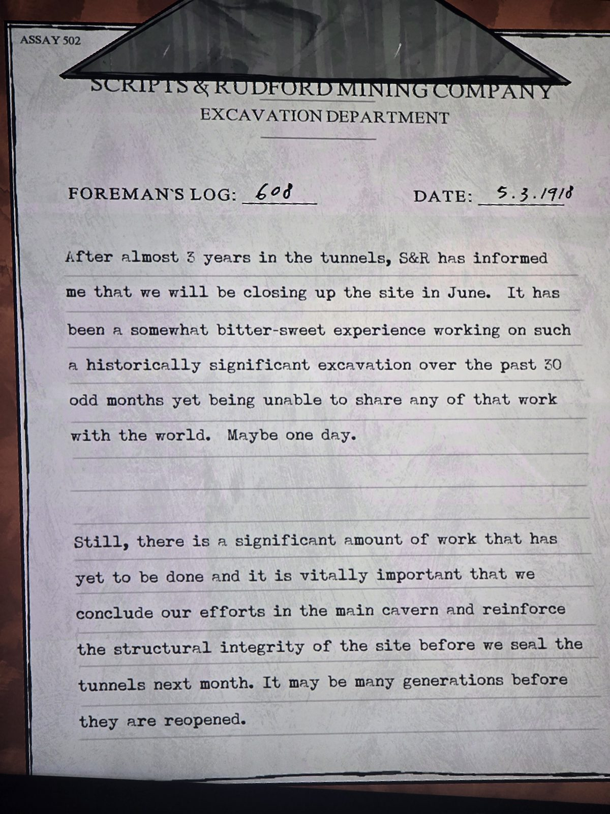

ASSAY 502 — SCRIPTS & RUDFORD MINING COMPANY, EXCAVATION DEPARTMENT. FOREMAN'S LOG: 608. DATE: 5.3.1918
After almost 3 years in the tunnels, S&R has informed me that we will be closing up the site in June. It has been a somewhat bitter-sweet experience working on such a historically significant excavation over the past 30 odd months yet being unable to share any of that work with the world. Maybe one day.
Still, there is a significant amount of work that has yet to be done and it is vitally important that we conclude our efforts in the main cavern and reinforce the structural integrity of the site before we seal the tunnels next month. It may be many generations before they are reopened.

## Photos / Фото

