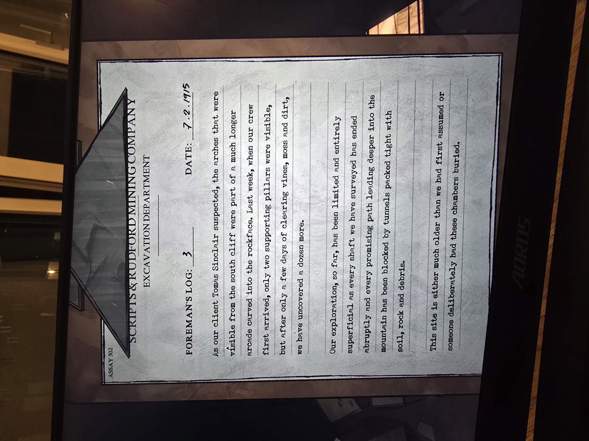

Журнал прораба №3, 7.2.1915 (Assay 502).
Как и подозревал заказчик **Томас Синклер**, арки, видные с южного утёса, — часть длинной аркады, высеченной в скале. Неделю назад было видно две опорные колонны, после расчистки — ещё дюжина.
Исследование пока поверхностное: каждая шахта резко обрывается, все пути вглубь горы забиты землёй, камнями и обломками.
«Либо это место гораздо древнее, чем мы думали, **либо кто-то намеренно засыпал эти залы**».

*Где найден — не записано (фото с экрана).*

## Photos / Фото

