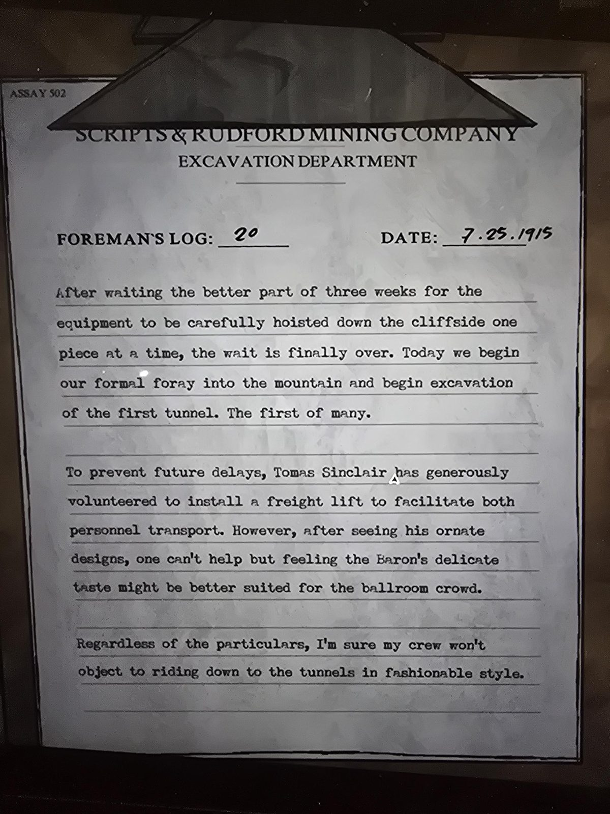

# Журнал бригадира №20 (7.25.1915)
Найден: **Abandoned Mine**, комната со свечами ([решения](../../../rooms/abandoned-mine/solutions.md)). Бланк **Scripts & Rudford Mining Company**, отдел раскопок. В углу: ASSAY 502. Дата записана как **7.25.1915** (то есть **25 июля 1915**, формат месяц.день.год).

Почти три недели мы ждали, пока оборудование осторожно, по одной детали, спустят по склону утёса. Ожидание наконец закончилось. Сегодня мы начинаем формальный заход в гору и приступаем к раскопкам **первого туннеля**. Первого из многих.

Чтобы избежать дальнейших задержек, **Томас Синклер** великодушно вызвался установить **грузовой лифт** для облегчения и [перевозки грузов, и] перевозки персонала (в оригинале слово «both» без пары, видимо опечатка). Однако, увидев его вычурные проекты, невольно думаешь, что тонкий вкус барона подошёл бы скорее публике бального зала.

Как бы то ни было, уверен, моя бригада не станет возражать против спуска в туннели в модном стиле.

## Заметка
- Барон **Томас Синклер** строит грузовой лифт на утёсе; возможная связь с [лифтом Foundation](../../../rooms/master-bedroom/docs/foundation-elevator-note/ru.md) (не проверено).
- Серия: [журналы бригадира](../README.md). №3 того же года ([7.2.1915](../log-003-1915-07-02/ru.md)) — ранее, начало работ у утёса.

## Photos / Фото

