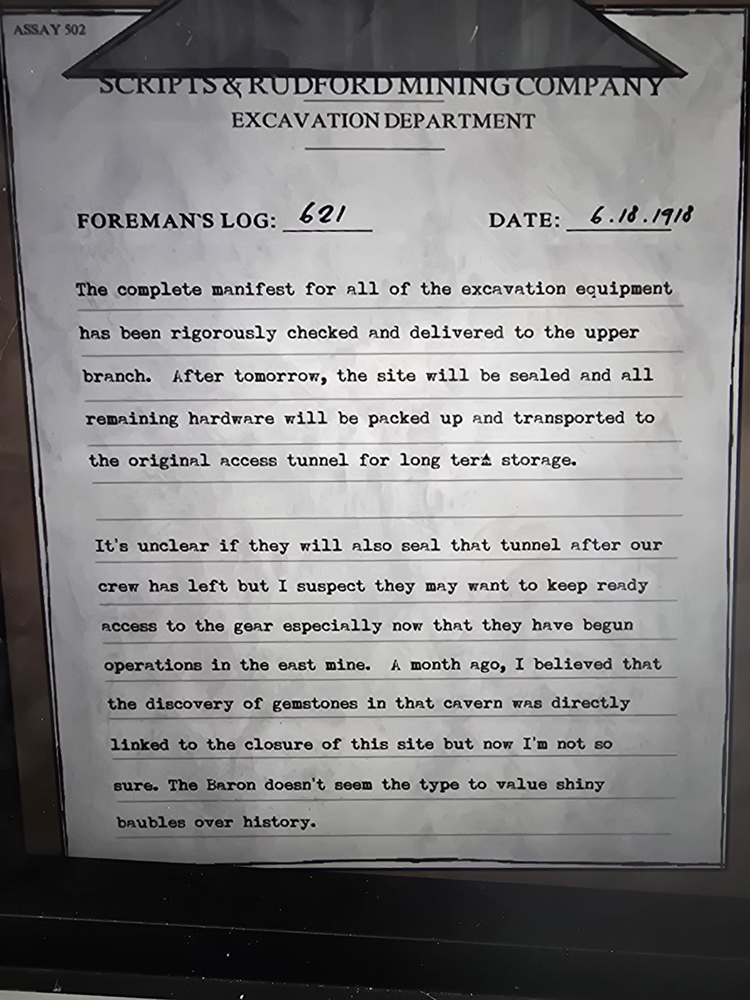

# Журнал бригадира №621 (6.18.1918 = 18 июня 1918)
Найден в **The Grounds**. Бланк **Scripts & Rudford Mining Company**, отдел раскопок. В углу: ASSAY 502.

Полная опись всего раскопочного оборудования тщательно проверена и доставлена в **верхнее ответвление**. После завтрашнего дня площадка будет запечатана, а всё оставшееся оборудование упаковано и перевезено в **первоначальный подъездной туннель** для длительного хранения.

Неясно, запечатают ли и тот туннель после ухода нашей бригады, но я подозреваю, что они захотят сохранить лёгкий доступ к снаряжению, особенно теперь, когда начались работы в **восточной шахте**. Месяц назад я считал, что открытие самоцветов в той пещере напрямую связано с закрытием этой площадки, но теперь я не так уверен. Барон не похож на человека, который ценит блестящие безделушки выше истории.

## Заметка
- Продолжение серии: [№608](../log-608-1918-05-03/ru.md) (запечатать туннели «в следующем месяце»). Самоцветы в пещере: [Gemstone Cavern](../../../rooms/gemstone-cavern/solutions.md).

## Photos / Фото

