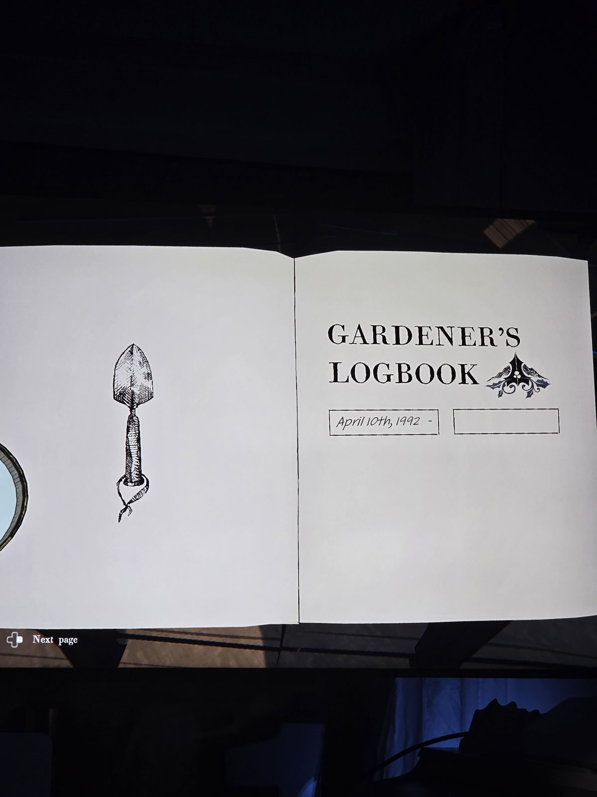
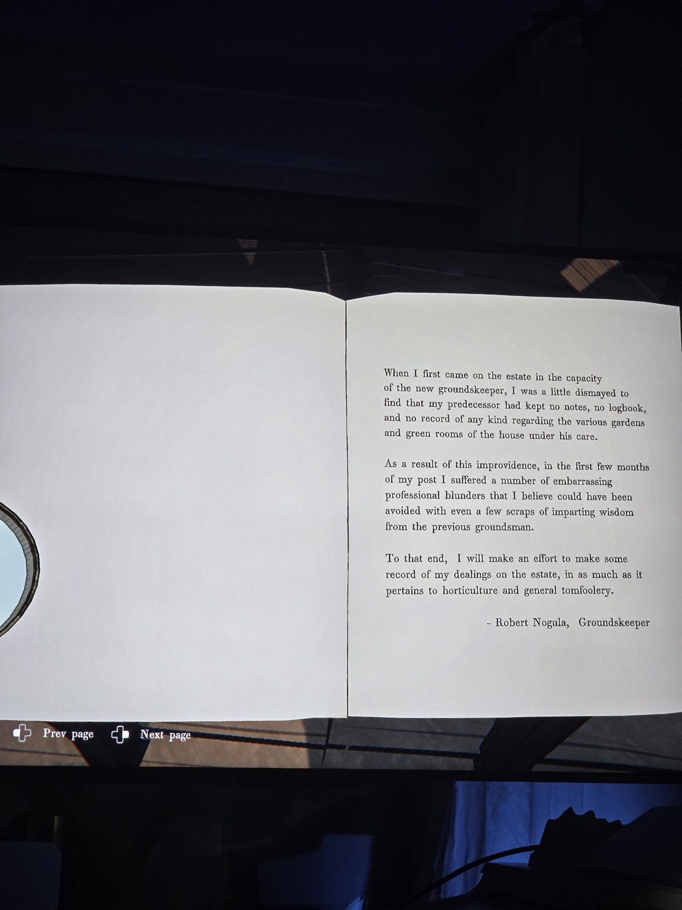
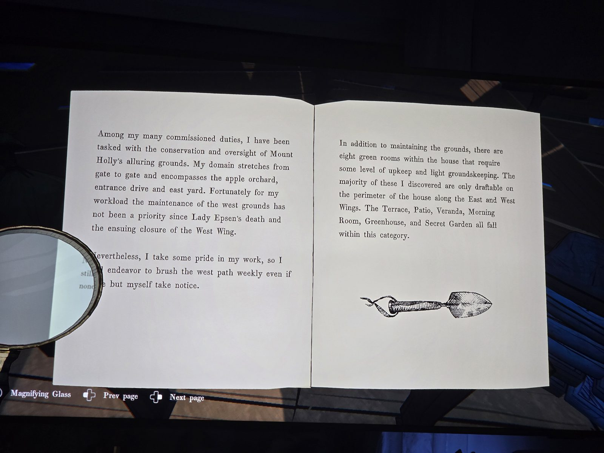
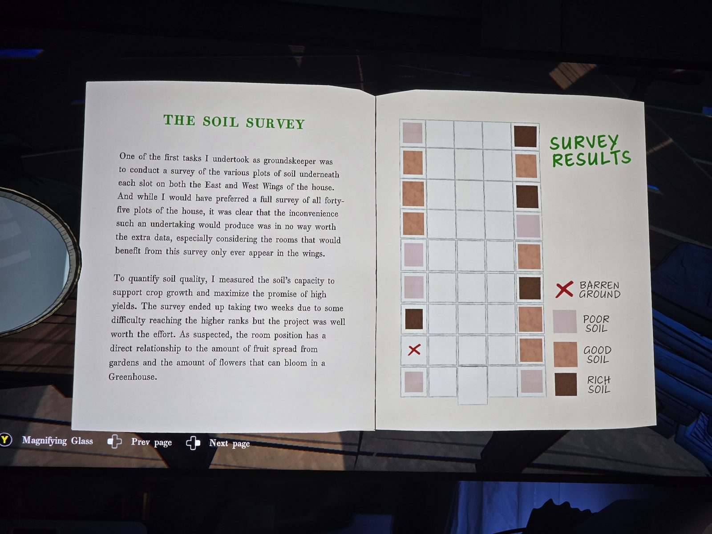
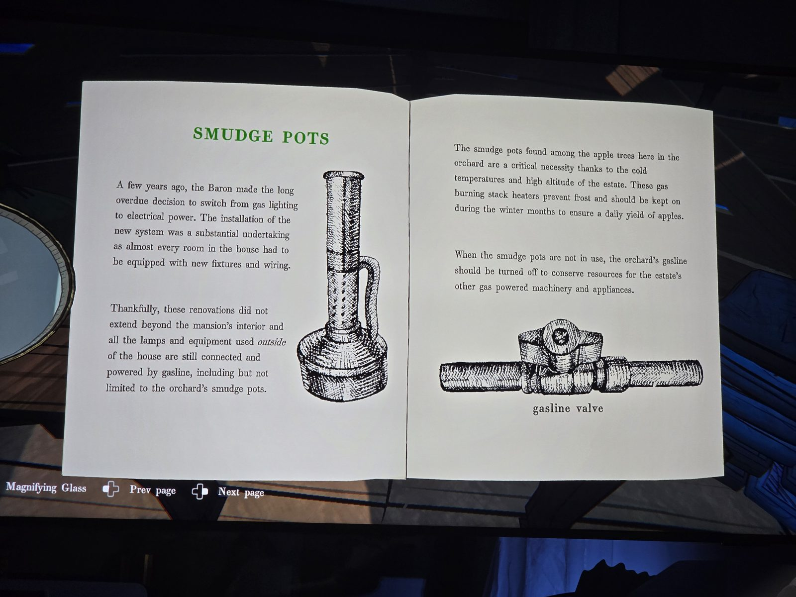
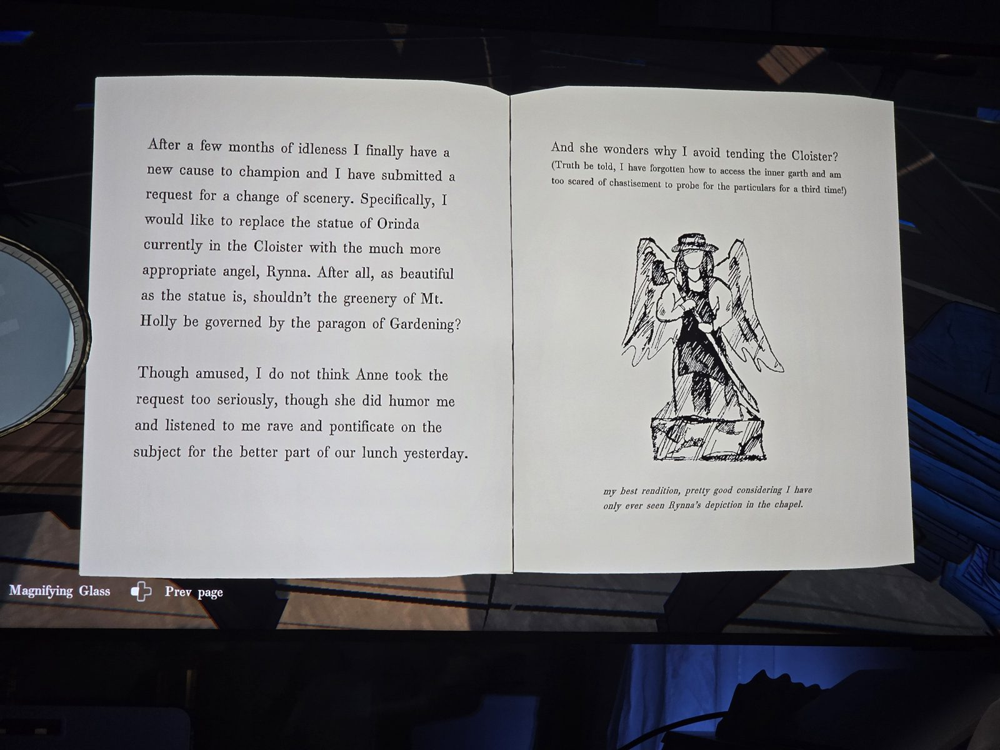

ЖУРНАЛ САДОВНИКА (Роберт Ногула, с 10.04.1992)
- Предшественник (Ревейн) не вёл записей.
- 8 «зелёных» комнат, драфтятся только по краям (восточное/западное крыло): Terrace, Patio, Veranda, Morning Room, Greenhouse, Secret Garden и др. Западную территорию после смерти леди Эпсен почти не обслуживают, западную дорожку он метёт раз в неделю.
- **Карта почвы** (качество влияет на фрукты и цветы в Greenhouse):

| Ряд | Запад (стб 1) | Восток (стб 5) |
|---|---|---|
| 9 | бедная | **богатая** |
| 8 | хорошая | хорошая |
| 7 | хорошая | **богатая** |
| 6 | хорошая | бедная |
| 5 | бедная | хорошая |
| 4 | бедная | **богатая** |
| 3 | **богатая** | хорошая |
| 2 | ❌ пустая | хорошая |
| 1 | бедная | бедная |

- **Обогреватели (smudge pots)** в яблоневом саду работают на газе: для урожая нужен открытый **газовый вентиль** сада.
- **Cloister**: хотел заменить статую Ориндии ангелом садоводства Рынной (видел в часовне); признаётся, что **забыл, как попасть во внутренний двор Cloister**.

## Photos / Фото

