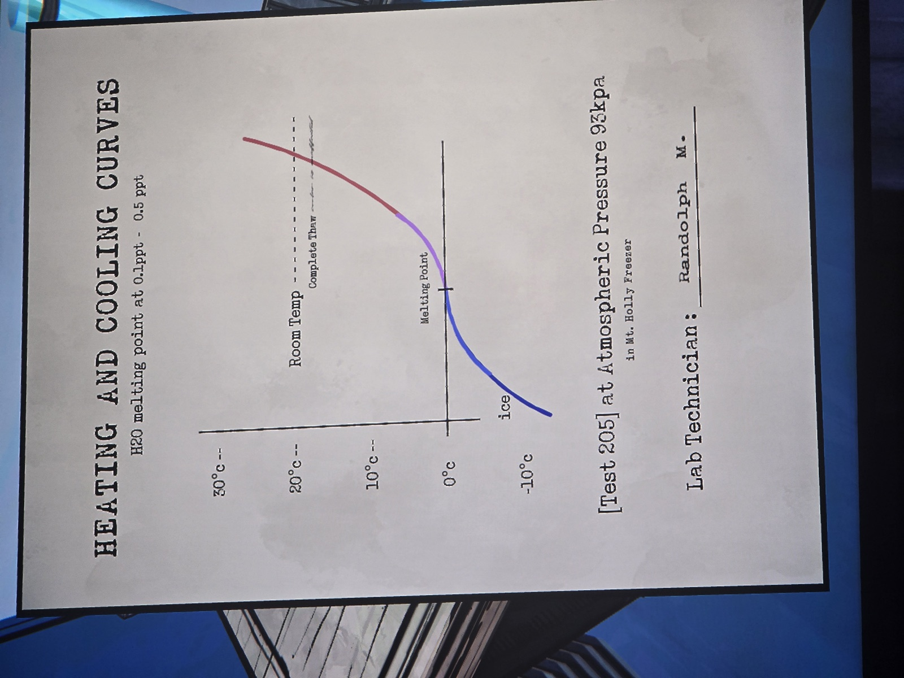

HEATING AND COOLING CURVES — H2O melting point at 0.1ppt – 0.5 ppt
Graph −10°C … 30°C: ice (blue) rising to the Melting Point at 0°C, then purple, then red rising past Room Temp (~20°C). "Complete Thaw" just below Room Temp (handwritten note after it, crossed out / unreadable).
[Test 205] at Atmospheric Pressure 93kpa in Mt. Holly Freezer.
Lab Technician: Randolph M.

## Photos / Фото

