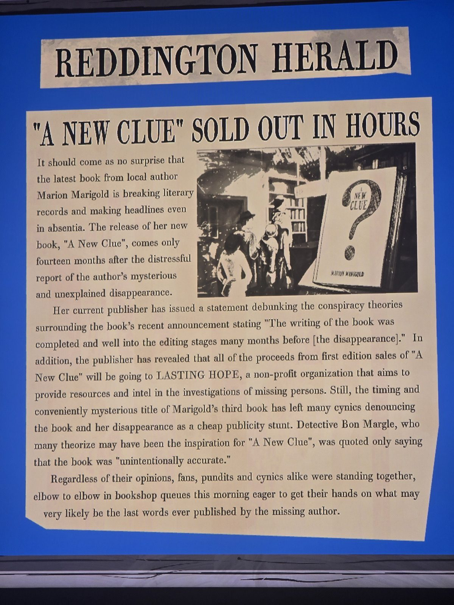

«Реддингтонский вестник»: **«A New Clue» РАСКУПЛЕН ЗА НЕСКОЛЬКО ЧАСОВ**
Новая книга Мэрион Мариголд бьёт рекорды даже в отсутствие автора: вышла через **14 месяцев** после её исчезновения (≈ апрель 1988). Издатель: книга была написана и редактировалась задолго до исчезновения; доход от первого тиража — фонду **LASTING HOPE** (поиск пропавших). Скептики называют всё рекламным трюком. Детектив **Бон Маргл**, возможный прообраз героя книги, сказал лишь, что книга «нечаянно точна».
Очереди в книжных — за, возможно, последними словами пропавшей писательницы.
*Комната не записана.*

## Photos / Фото

