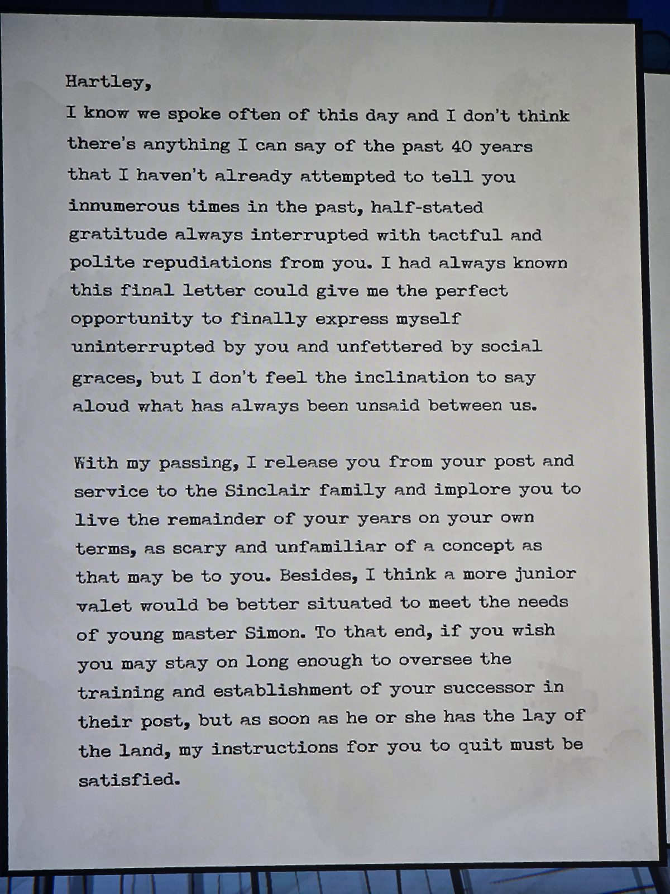
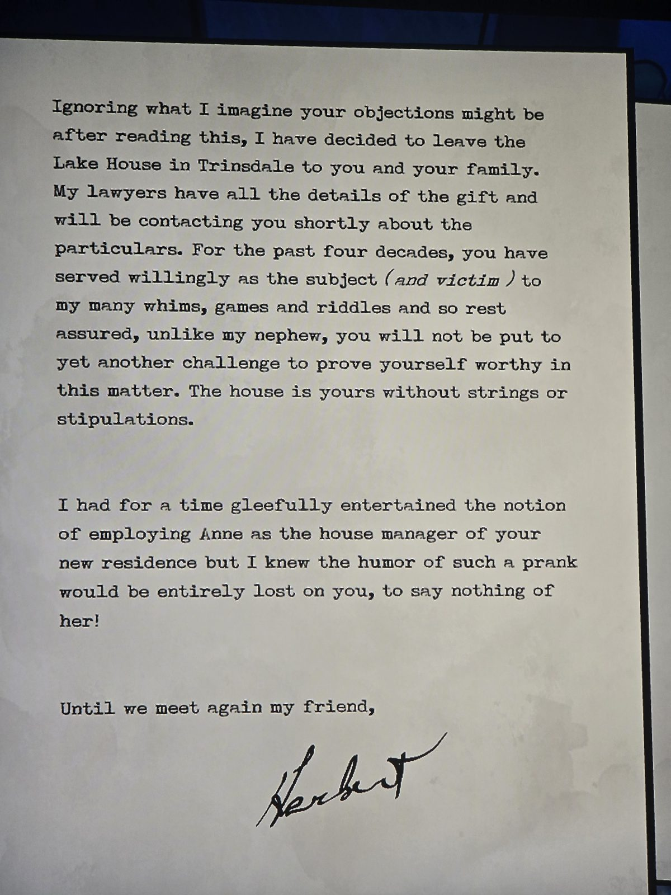

Hartley,
I know we spoke often of this day and I don't think there's anything I can say of the past 40 years that I haven't already attempted to tell you innumerous times in the past, half-stated gratitude always interrupted with tactful and polite repudiations from you…
With my passing, I release you from your post and service to the Sinclair family and implore you to live the remainder of your years on your own terms… I think a more junior valet would be better situated to meet the needs of young master Simon…
Ignoring what I imagine your objections might be after reading this, I have decided to leave the Lake House in Trinsdale to you and your family… For the past four decades, you have served willingly as the subject (and victim) to my many whims, games and riddles and so rest assured, unlike my nephew, you will not be put to yet another challenge to prove yourself worthy in this matter. The house is yours without strings or stipulations.
I had for a time gleefully entertained the notion of employing Anne as the house manager of your new residence but I knew the humor of such a prank would be entirely lost on you, to say nothing of her!
Until we meet again my friend, Herbert

## Photos / Фото

