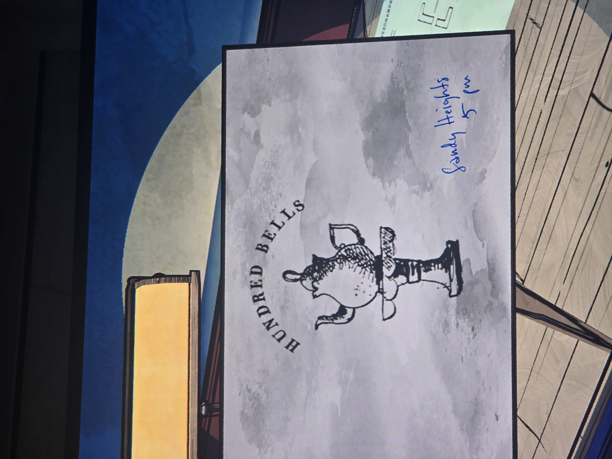

Визитка **Hundred Bells** («Сто колоколов» — чайная, где в последний раз видели Мэри) с эмблемой-чайником. От руки синими: **«Sandy Heights, 5 pm»**.

*Заметка: Sandy Heights — адрес доставки из записки в гараже (14227 Sandy Heights, Тринсдейл). Связывает «товар» шофёра Кристофа, Денни Ревейна и место исчезновения Мэри. Комната не записана.*

## Photos / Фото

