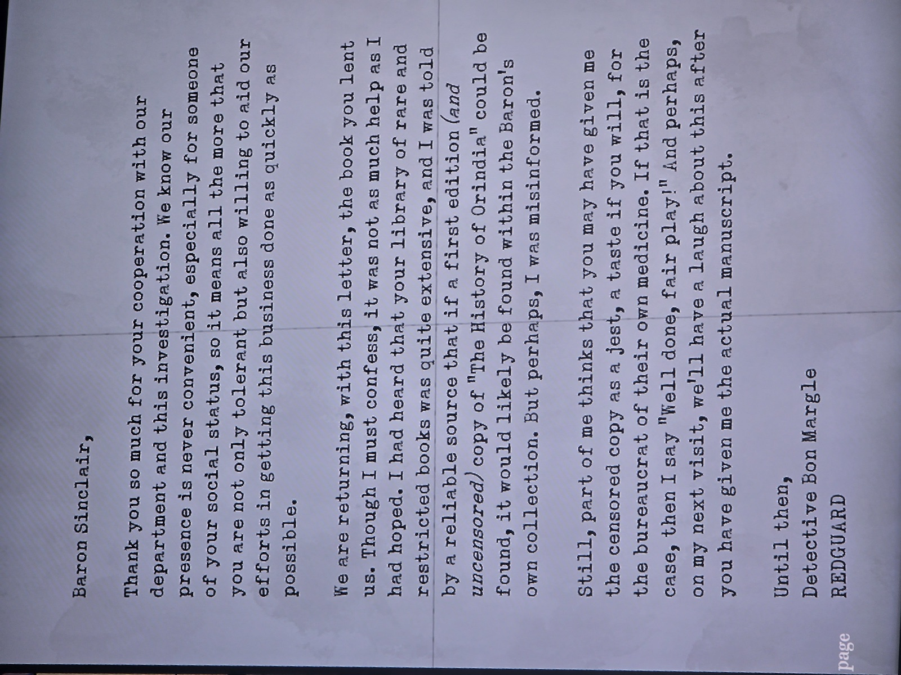

Барон Синклер,
спасибо за сотрудничество с нашим отделом и расследованием. Возвращаем книгу, которую вы одолжили, — но помогла она меньше, чем я надеялся. Мне говорили, что ваша библиотека редких и **запрещённых** книг обширна и что если где и найдётся первое (**нецензурированное**) издание «Истории Ориндии», то у барона.
Возможно, вы дали мне цензурированный экземпляр в шутку — угостили бюрократа его же лекарством. Если так — «браво, честная игра!». В следующий визит посмеёмся, когда вы отдадите настоящую рукопись.
Детектив Бон Маргл, REDGUARD.

*Заметка: Маргл брал Swim Bird в библиотеке 2.3.1987 (карточка) — расследование исчезновения Мэри. Существует нецензурированная «History of Orindia» (Caleb Manning) — стоит искать в Library. Комната находки не записана.*

## Photos / Фото

