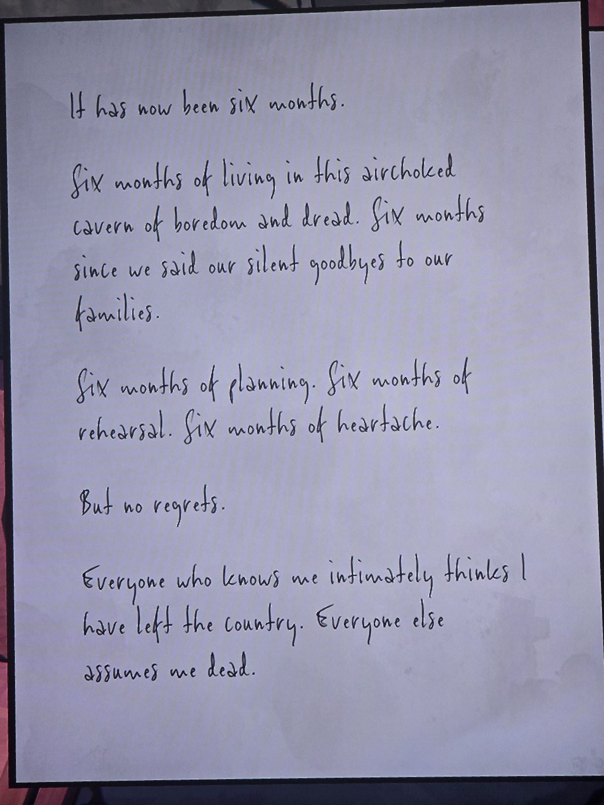
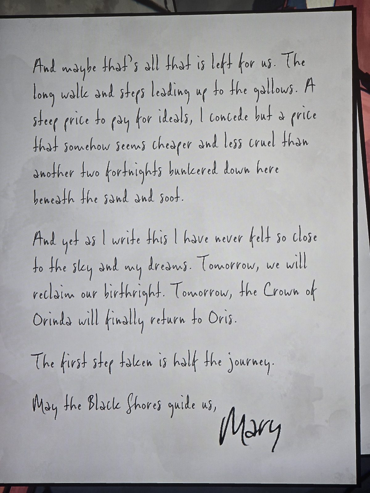

**Письмо Мэри из укрытия** (2 страницы):
«Прошло шесть месяцев. Шесть месяцев в этой душной пещере скуки и страха. Шесть месяцев с тех пор, как мы молча попрощались с семьями. Шесть месяцев планирования, репетиций, сердечной боли. Но без сожалений.
Все, кто близко меня знает, думают, что я уехала из страны. Остальные считают меня мёртвой.
Может, нам осталась лишь долгая дорога на эшафот. Высокая цена за идеалы — но она кажется дешевле и милосерднее, чем ещё месяц («две пары недель») в бункере **под песком и сажей**.
И всё же я никогда не чувствовала себя так близко к небу и мечтам. **Завтра мы вернём своё право по рождению. Завтра Корона Ориндии наконец вернётся в Орис.**
Первый шаг — половина пути. Да ведут нас Чёрные Берега. — Мэри»

*Заметка: ключ к сюжету. Мэри **жива** на момент ограбления: исчезла 20.02.1987, «шесть месяцев» → конец августа 1987, «завтра» = ограбление Королевского музея 1.09.1987 (Рубиновая корона = Crown of Orinda). «Чёрные Берега» — Дети Чёрной Воды / RLCF. Корона «возвращается в Орис» (белый замок Oris на карте Fenn Aries). «Под песком и сажей» — бункер (Shelter?). Комната не записана.*

## Photos / Фото

