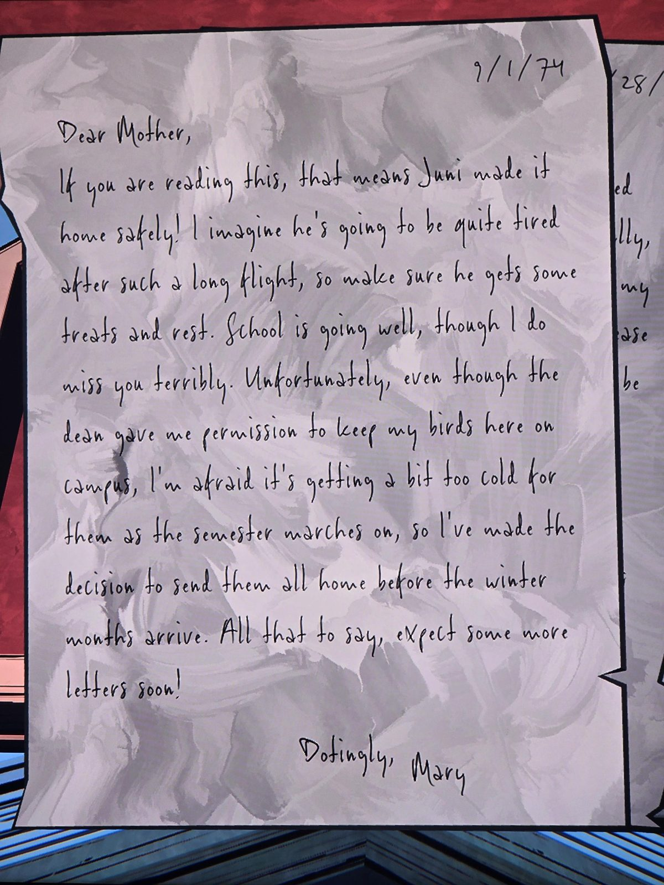
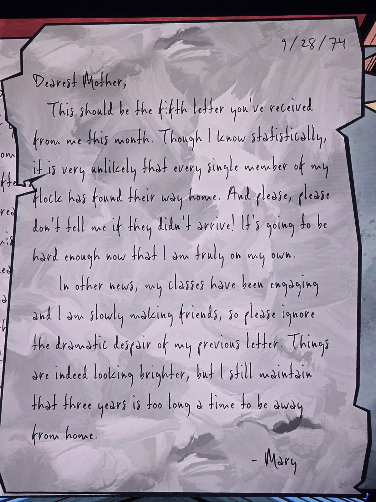
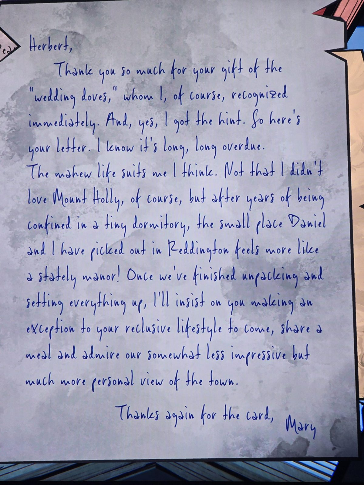
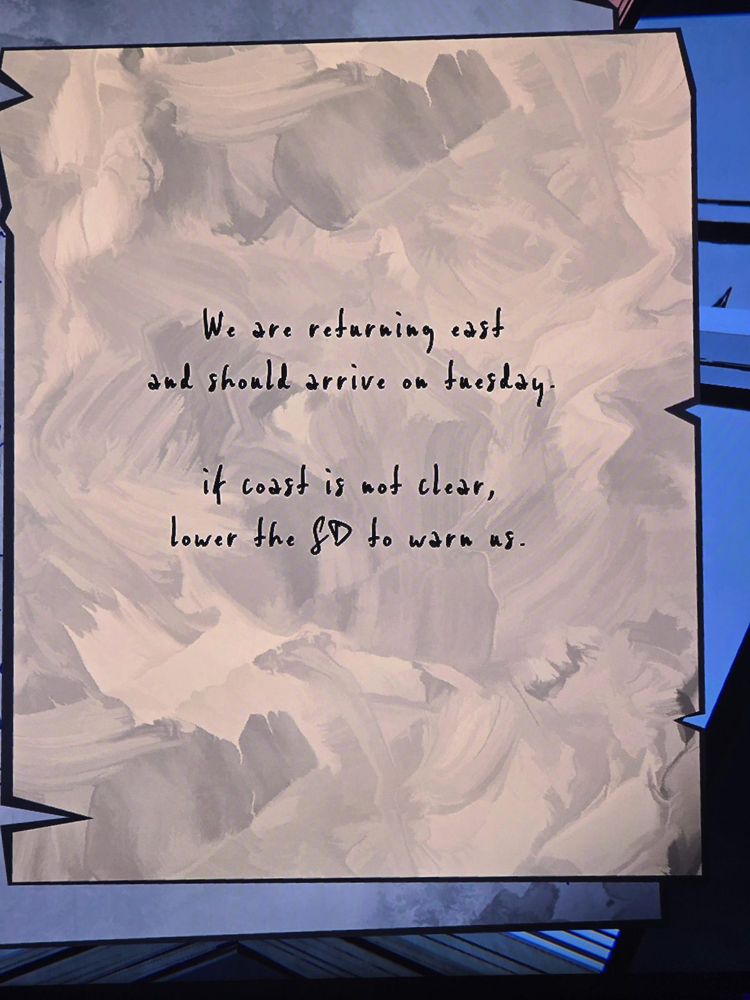

Письма Мэри (почтовыми голубями):
- **1.09.74** — «Мама, раз ты это читаешь, Джуни долетел! Покорми его и дай отдохнуть. Учёба хорошо, скучаю. В кампусе птицам становится холодно — отправлю всех домой до зимы, жди ещё писем! С нежностью, Мэри».
- **28.09.74** — «Это должно быть пятое письмо за месяц. Вряд ли долетели все птицы — не говори, если кто-то не долетел! Занятия интересные, завожу друзей, забудь моё прошлое отчаянное письмо. Но три года вдали от дома — слишком долго».
- **Герберту** (синими чернилами) — «Спасибо за „свадебных голубей“ — я их сразу узнала и намёк поняла, вот письмо. Семейная жизнь мне подходит. Домик, который мы с **Дэниелом** выбрали в **Реддингтоне**, после общежития кажется поместьем! Приезжай в гости, сделай исключение из затворничества».
- **Записка** — «Возвращаемся на восток, будем во **вторник**. Если путь не свободен — опусти **SD**, чтобы предупредить нас». (SD — не расшифровано.)

## Photos / Фото

