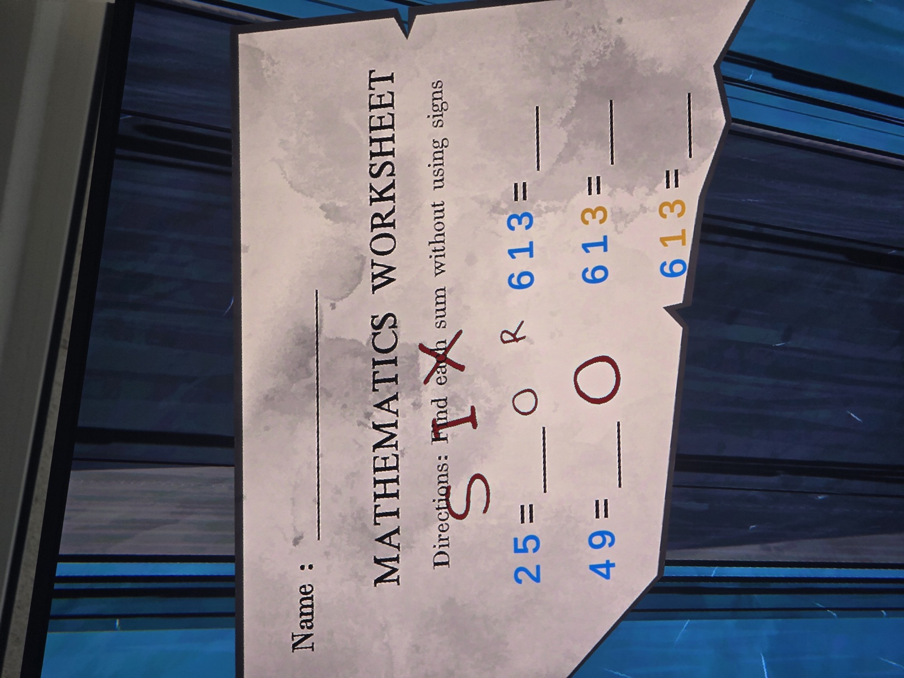

Ещё один лист «найдите сумму без знаков» (синий +, жёлтый −):
25 = 7 · 49 = 13 · 613 = 10 · 61**3** = 4 · 6**13** = 2.
Поверх красным от руки: **SIX**, мелкие «O» и «R», крупное обведённое «O» → вместе похоже на **SIX OR O…**? (6, 0…). Возможно, ребус или код.

*Не решено. Комната не записана (другой лист — в Classroom).*

## Photos / Фото

