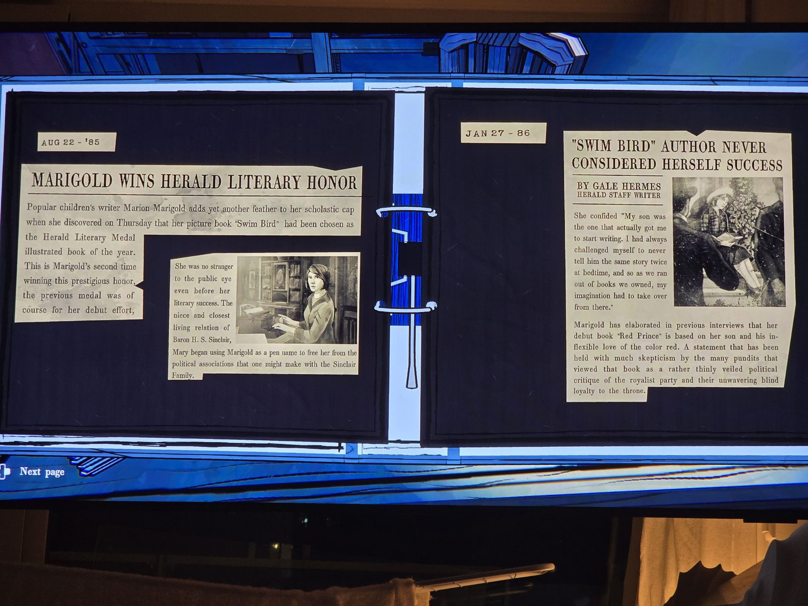
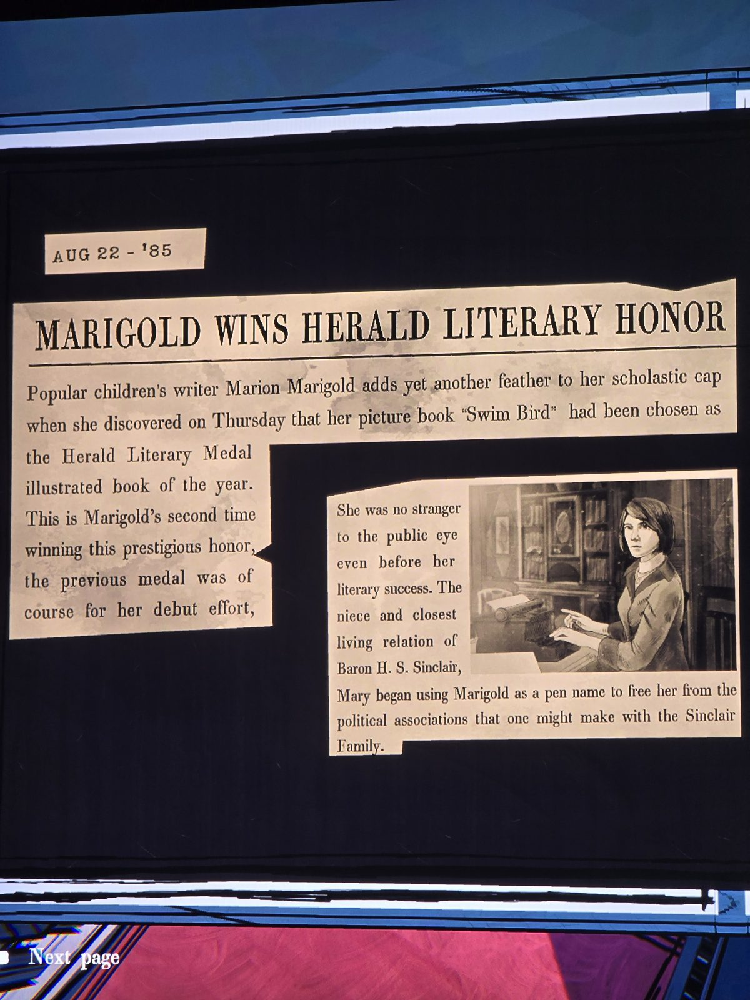
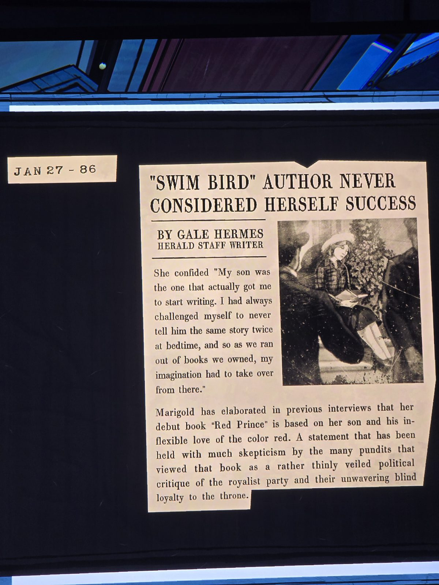
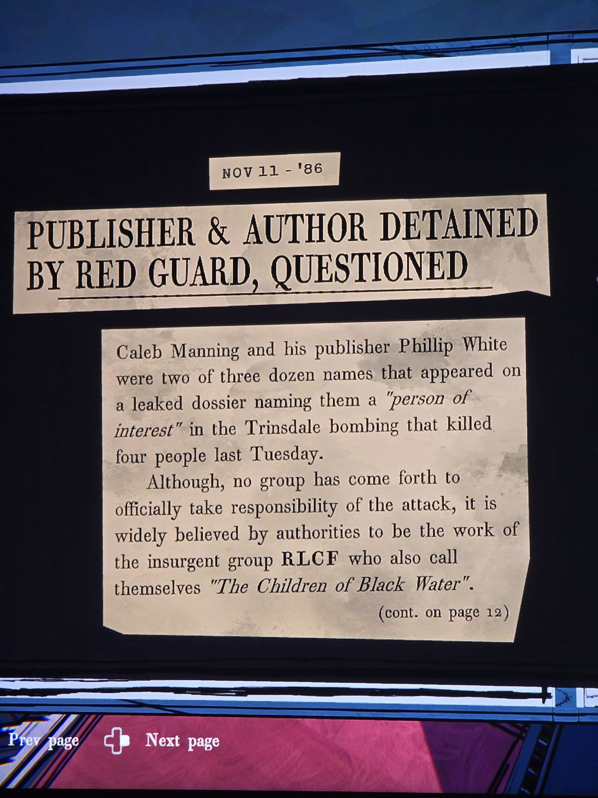
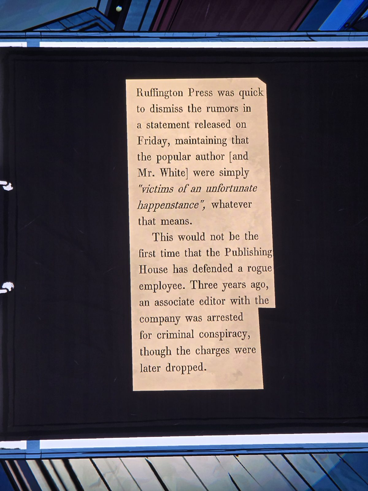
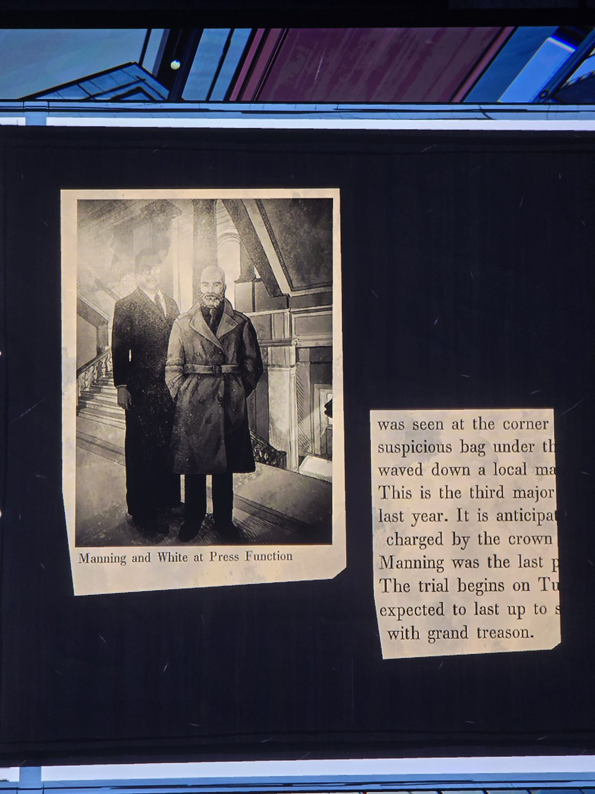
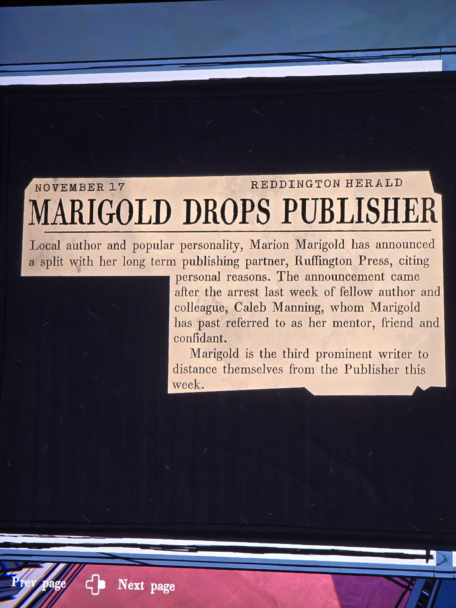
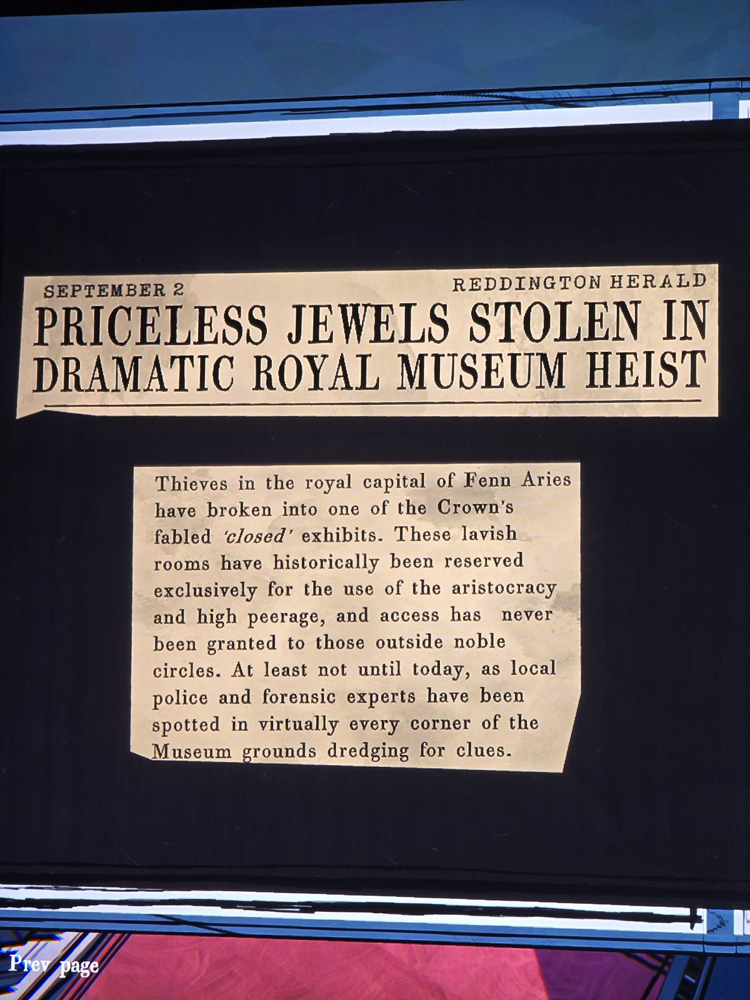
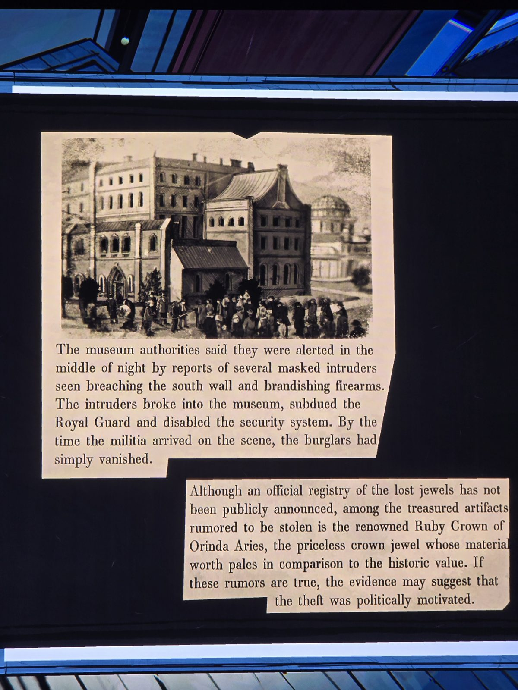
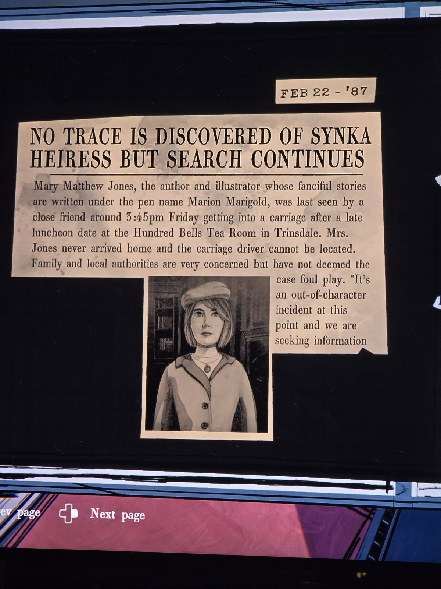

Scrapbook of clippings:
- Aug 22 '85 — MARIGOLD WINS HERALD LITERARY HONOR: picture book "Swim Bird" chosen as the Herald Literary Medal illustrated book of the year; second time (previous — her debut). She is the niece and closest living relation of Baron H. S. Sinclair; Mary began using Marigold as a pen name to free her from the political associations of the Sinclair family.
- Jan 27 '86 — "SWIM BIRD" AUTHOR NEVER CONSIDERED HERSELF SUCCESS (Gale Hermes): "My son was the one that actually got me to start writing…" Debut book "Red Prince" is based on her son and his inflexible love of the color red; pundits viewed it as a thinly veiled political critique of the royalist party.
- Nov 11 '86 — PUBLISHER & AUTHOR DETAINED BY RED GUARD, QUESTIONED: Caleb Manning and publisher Phillip White among three dozen "persons of interest" in the Trinsdale bombing that killed four people; attributed to insurgent group RLCF, "The Children of Black Water". (cont.) Manning charged by the crown with grand treason; trial begins Tuesday. Ruffington Press: authors were "victims of an unfortunate happenstance"; three years ago an associate editor was arrested for criminal conspiracy, charges later dropped.
- November 17 (Reddington Herald) — MARIGOLD DROPS PUBLISHER: split with Ruffington Press for personal reasons after the arrest of her mentor Caleb Manning; third prominent writer to leave this week.
- September 2 (Reddington Herald) — PRICELESS JEWELS STOLEN IN DRAMATIC ROYAL MUSEUM HEIST: thieves broke into one of the Crown's 'closed' exhibits in Fenn Aries; masked intruders breached the south wall, subdued the Royal Guard, disabled security; rumored stolen: the Ruby Crown of Orinda Aries; theft may be politically motivated.
- Feb 22 '87 — NO TRACE DISCOVERED OF SYNKA HEIRESS BUT SEARCH CONTINUES: Mary Matthew Jones (Marion Marigold) last seen ~3:45pm Friday getting into a carriage after a luncheon at the Hundred Bells Tea Room in Trinsdale; carriage driver cannot be located.

## Photos / Фото

