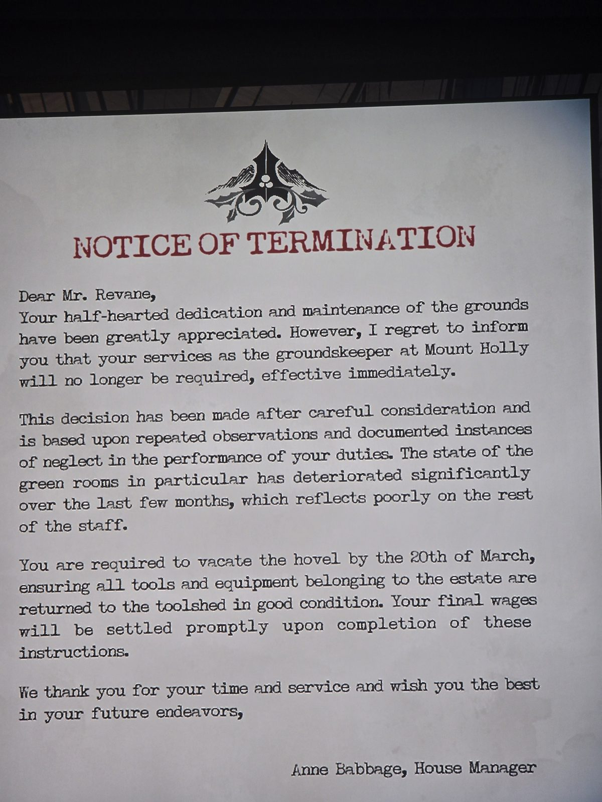

УВЕДОМЛЕНИЕ ОБ УВОЛЬНЕНИИ
Уважаемый мистер Ревейн, ваша вполсилы проявленная забота о территории высоко оценена. Однако ваши услуги садовника больше не требуются, с немедленным вступлением в силу.
Решение основано на неоднократной небрежности. Особенно ухудшилось состояние **«зелёных комнат»**.
Освободите **хижину** до 20 марта и верните инструменты в **сарай**. Расчёт — после этого.
Энн Бэббидж, управляющая домом

## Photos / Фото

