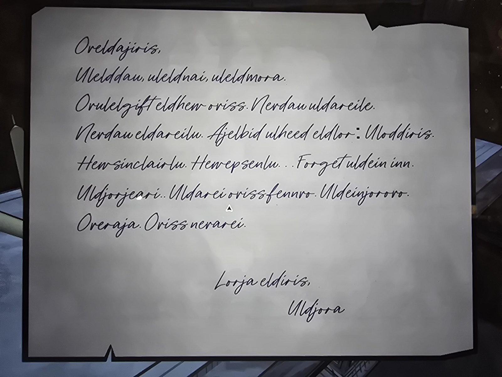

# Письмо на неизвестном языке (подпись Uldjora)
Рукописное письмо на **эраджанском** (слова и приставки те же, что на уроках [Grade 8](../../rooms/classroom/docs/grade-8-erajan-affixes/ru.md)), подпись **Uldjora**, обращение *Oreldajiris*, прощание *Lorja eldiris*. Транскрипция в [en.md](en.md), прочитана по курсиву приблизительно.

Где найдено: в гробнице Клары (секретная комната в [Tomb](../../rooms/tomb/solutions.md)).

## Попытка перевода (моя, не подтверждена игрой)
Опора: [словарь](../../rooms/classroom/docs/grade-8-erajan-vocabulary/ru.md), [приставки и суффиксы](../../rooms/classroom/docs/grade-8-erajan-affixes/ru.md) и работы Grade 8 (el = «я», ul = «ты»; -le / -lu = «без меня» / «без тебя»; ov = «к»; aj = «первый»; ja = «последний»; lor = «слово»; hew = «дом»; dau = день; nai = ночь; arei = будущее). Из самого письма выведено: **eld = «мой»**, **uld = «твой»**, **uleld = «наш»** (ul + el + d).

| Строка | Прочтение |
|---|---|
| Oreldajiris, | «(О?) мой первый iris» — iris по смыслу обращение; Or- неясно |
| Ulelddau, uleldnai, uleldmora. | «Наш день, наша ночь, наше mora» (mora в словаре нет, возможно «утро/завтра») |
| Orulelgift eldhew oriss. | «… gift (английский глагол «дарить») … мой дом Oris» — неясно, кто кому |
| Nerdau uldareile. Nerdau eldareilu. | «Ner-день: твоё будущее без меня. Ner-день: моё будущее без тебя» (ner неясно: «нет/никогда?») |
| Ajelbid ulheed eldlor: Uloddiris. | «Сначала я прошу (bid): ты услышь (heed) моё слово: Uloddiris» (Uloddiris неясно) |
| Hew sinclairlu. Hew epsenlu... | «Дом Sinclair без тебя. Дом Epsen без тебя...» |
| Forget uldein inn. | «Forget» (английское «забудь») … uldein inn — неясно |
| Uldjorjeari.. Uldarei orissfennro. Uldeinjororo. | «… Твоё будущее — Oris, [от?] Fenn (-ro) …» — неясно |
| Overaja. Oriss nerarei. | «К Eraja. У Oris нет (ner-) будущего» |
| Lorja eldiris, Uldjora | «Последнее слово, мой iris, Uldjora» |

**Общий смысл (догадка):** прощальное письмо; автор называет Sinclair и Epsen «без тебя», просит забыть что-то и идти «к Eraja», потому что у Oris нет будущего. Слова с «неясно» по доступному словарю не раскрываются.

## Photos / Фото

