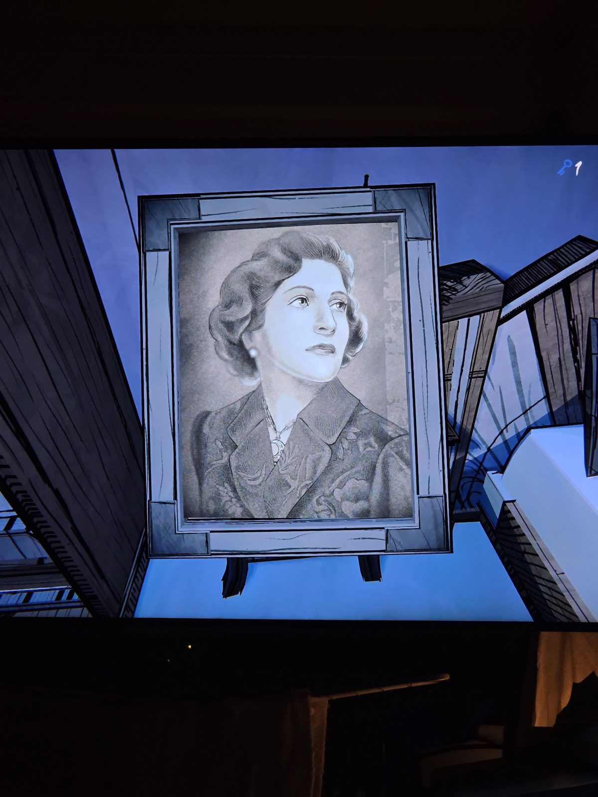
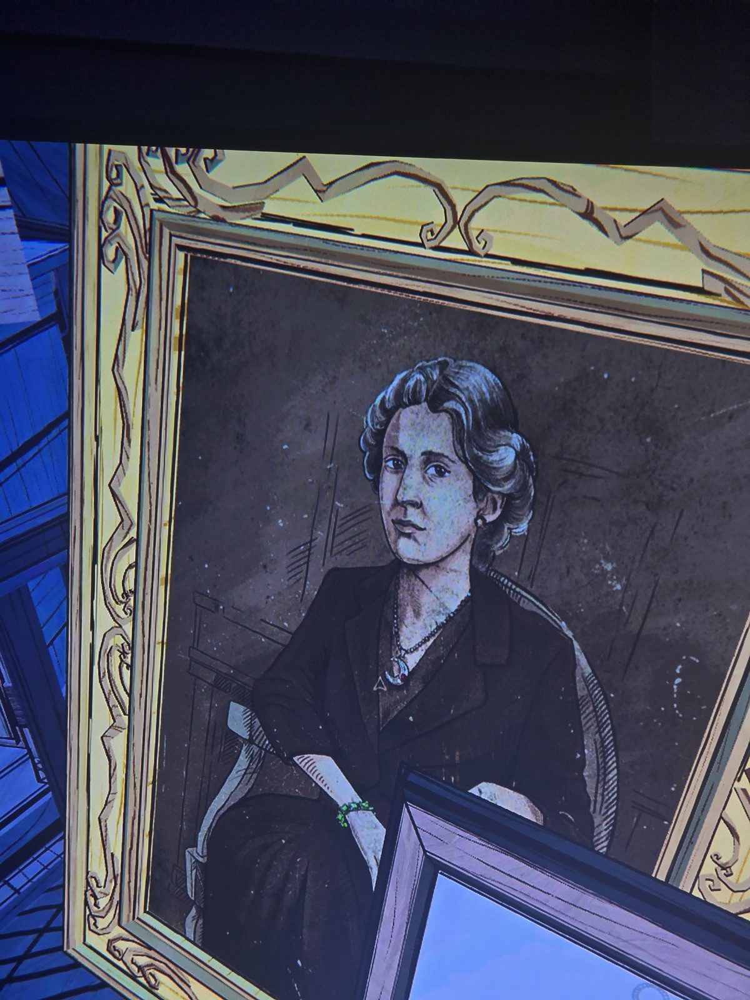
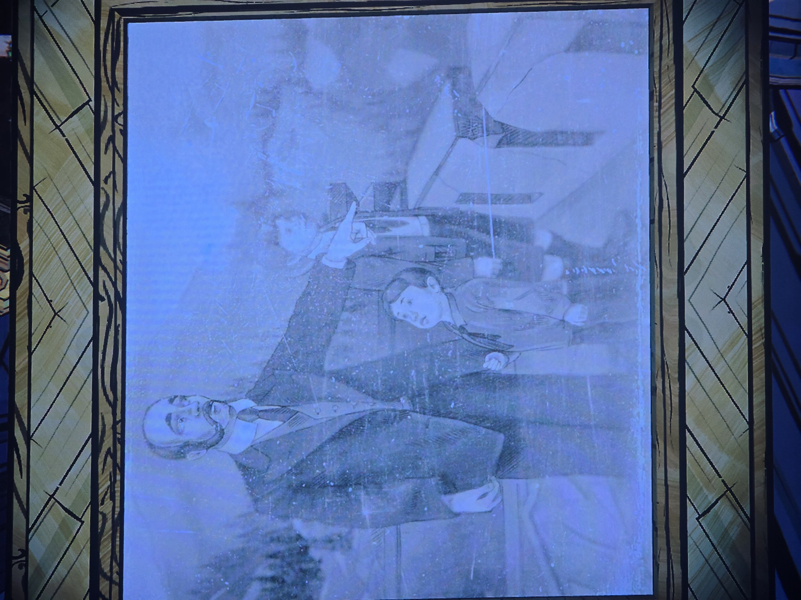
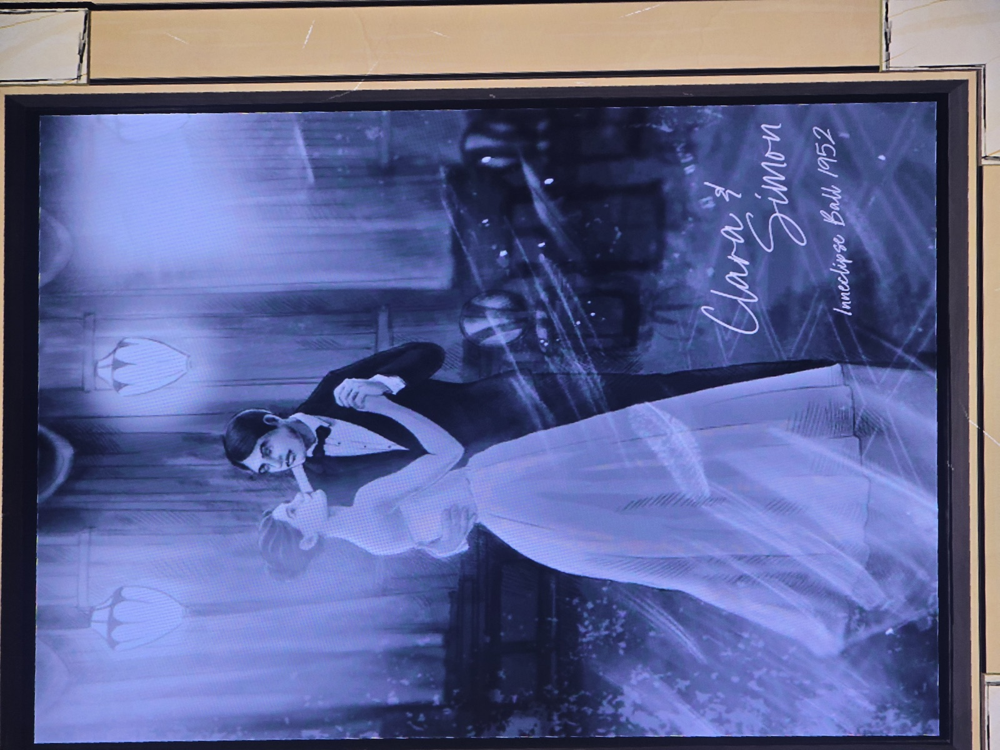
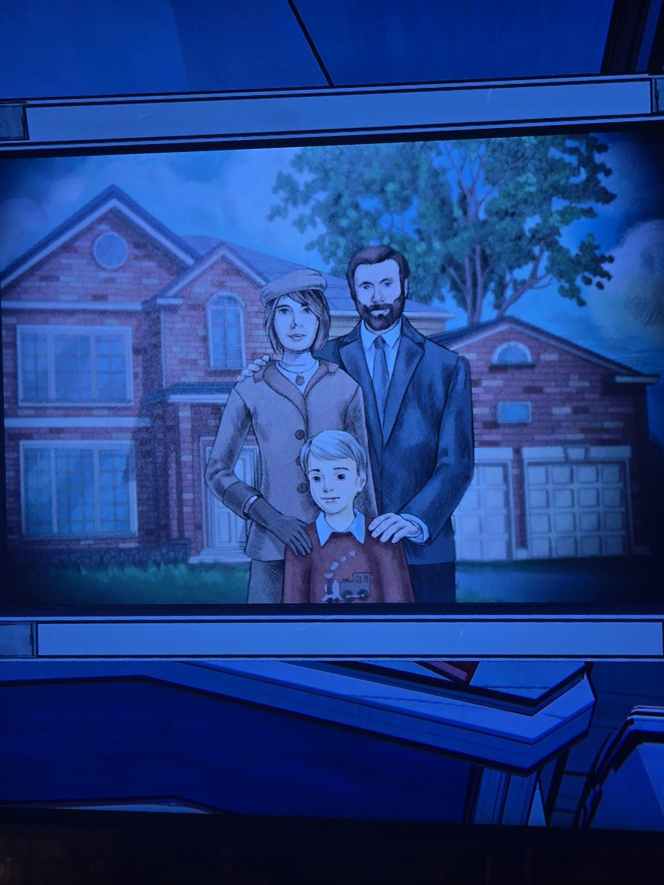

01 — Framed portrait of a woman (1930s waved hair, pearl earring).
02 — Framed portrait of a seated woman in black, pendant with a triangle charm and a red stone, green bracelet.
03 — Framed drawing: bald bearded man in a three-piece suit pointing into the distance, with two boys (younger one looking up at him), mountains and pines behind.
04 — Painting: couple dancing, signed "Clara & Simon — Inneclipse Ball 1952".
05 — Painting: family portrait in front of a brick house — Mary (beret, coat), Daniel (beard, suit) and young Simon.

## Photos / Фото

