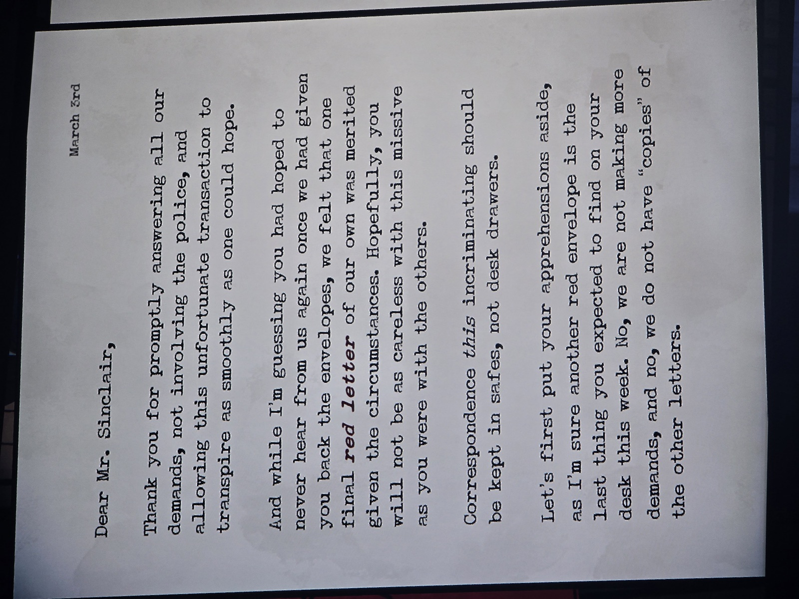
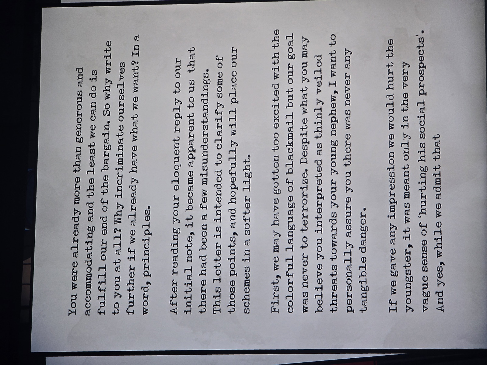
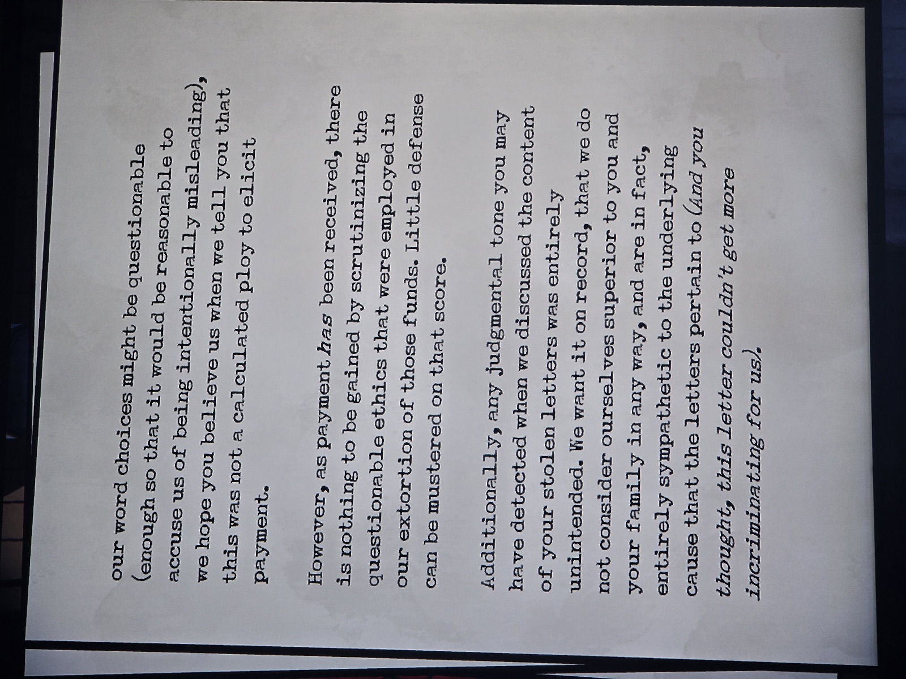
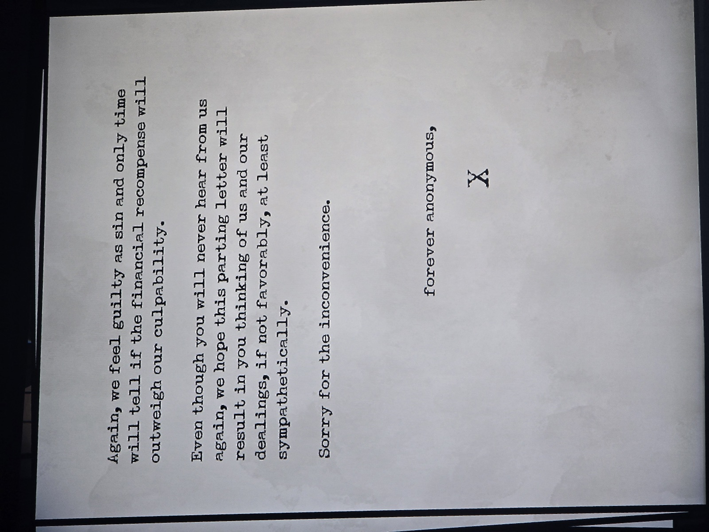

3 марта. «Уважаемый мистер Синклер», подпись — «навеки анонимный, X».

Шантажисты благодарят Синклера за то, что он быстро выполнил все требования и не обратился в полицию. Конверты (украденные письма) ему уже вернули, но они решили прислать «последнее **красное письмо** от себя». «Столь компрометирующую переписку надо хранить в сейфах, а не в ящиках стола».
Новых требований нет, «копий» других писем у них нет. Зачем пишут — «из принципа»: прояснить недоразумения.
- Угрозы «юному племяннику» были лишь в смысле «повредить его положению в обществе», реальной опасности не было.
- Деньги получены, оправдываться за вымогательство нечем.
- Они не считают себя выше его семьи и **сочувствуют делу, к которому относятся украденные письма** («а вы думали, письмо не может стать ещё компрометирующее для нас»).
«Виноваты как грех… Простите за беспокойство».

*Заметка: значит, «красные письма» — тайная переписка Герберта, связанная с повстанческим делом (см. красное письмо VII в Shelter). Их украли и вернули за выкуп. Подсказка «в сейфах, а не в ящиках» — красные письма стоит искать в сейфах. Год не указан; «юный племянник» — вероятно, Саймон-герой (внучатый племянник). Комната не записана.*

## Photos / Фото

