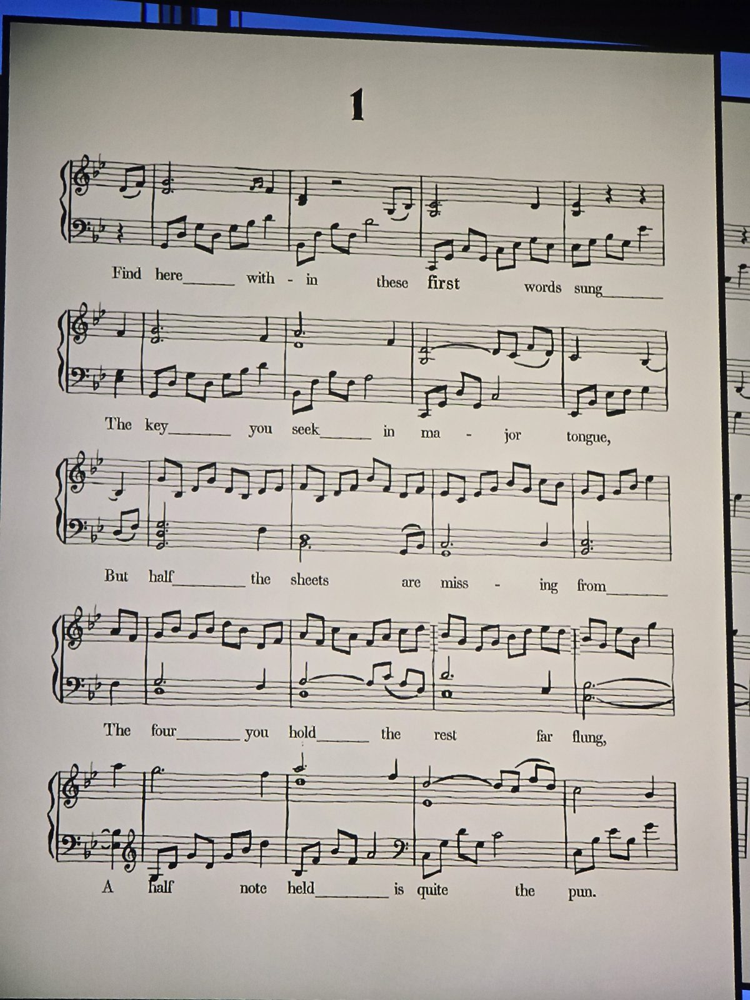
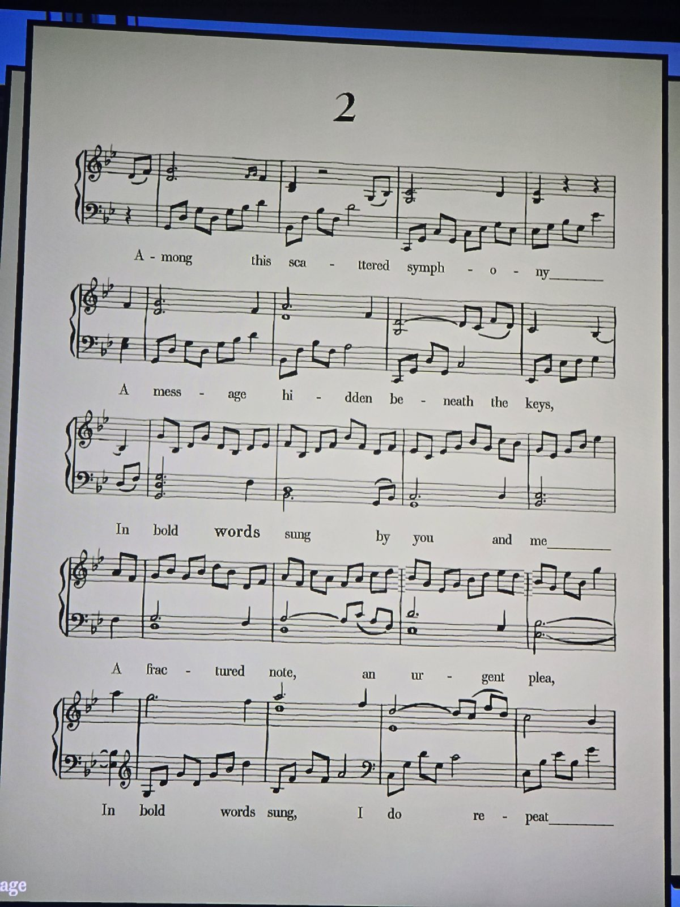
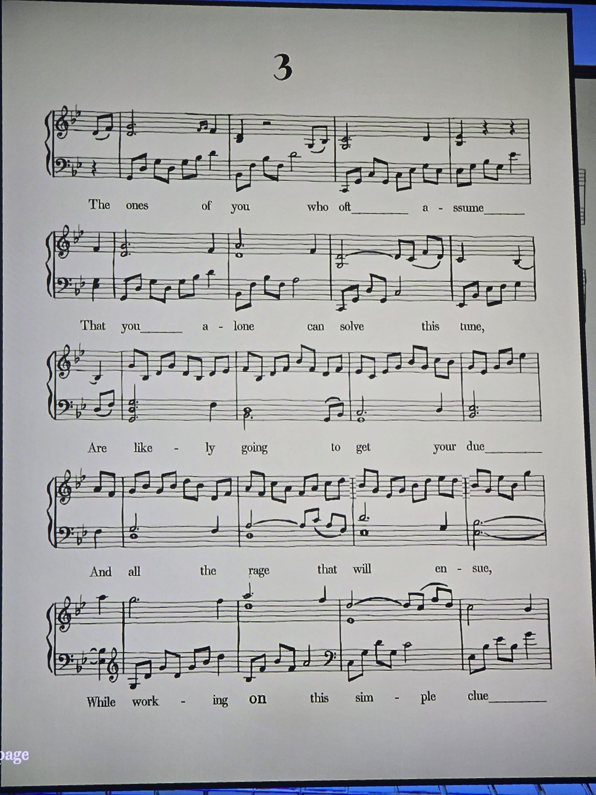
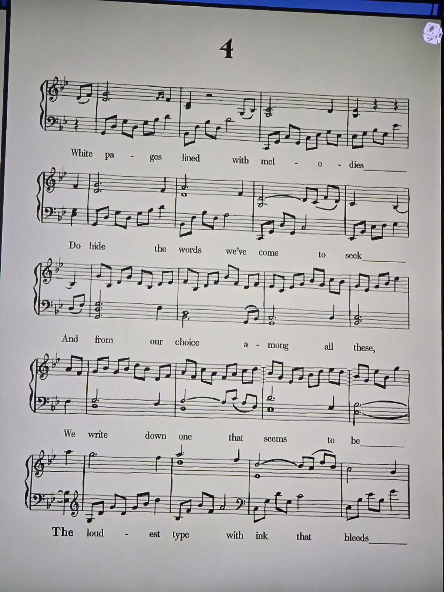
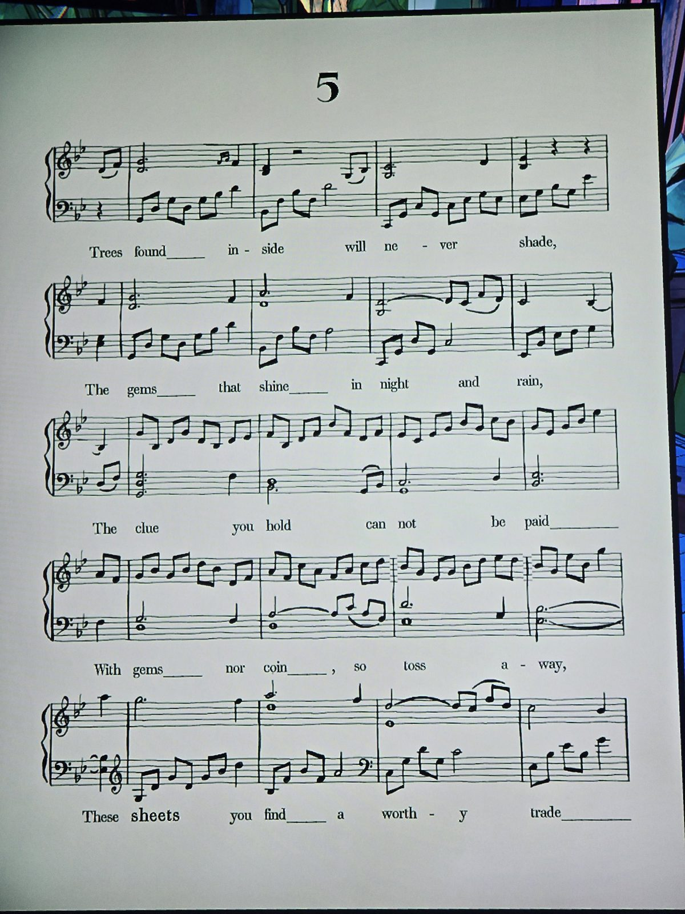
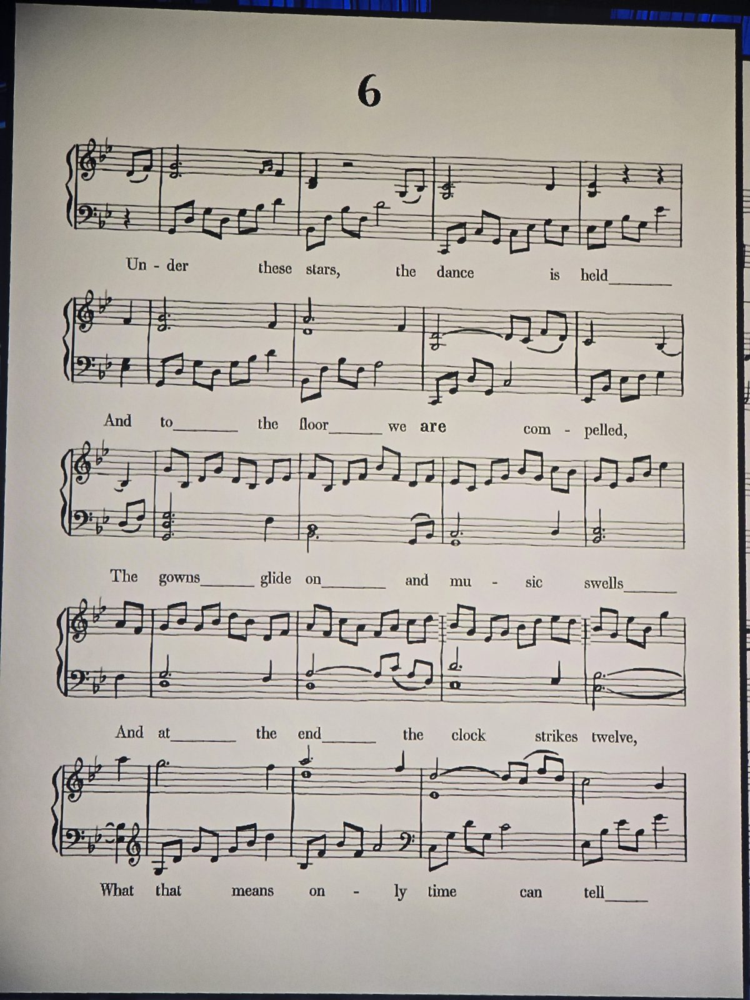
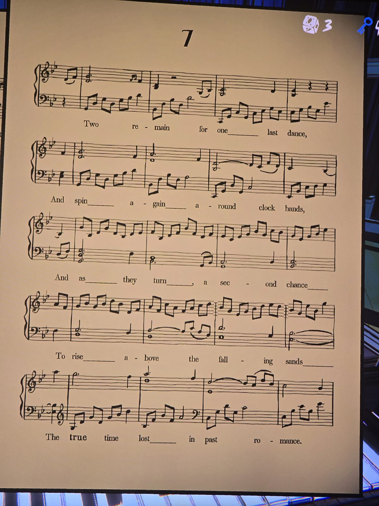
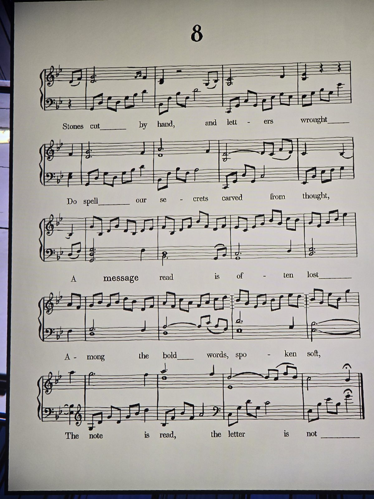

Восемь листов нот (1–8). Выделенные слова: first · words · on · the · sheets · are · true · message → «первые слова на листах и есть послание».
Первые слова листов 1–8: **Find · Among · The · White · Trees · Under · Two · Stones**
→ **FIND AMONG THE WHITE TREES UNDER TWO STONES** — «ищи среди белых деревьев, под двумя камнями».

## Photos / Фото

