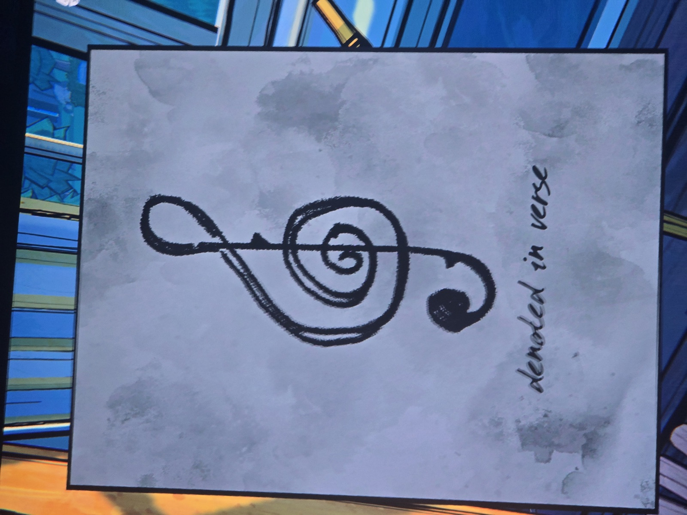

Рисунок: скрипичный ключ. Подпись: «обозначено в стихах» (denoted in verse).
*Заметка: возможно, связь с нотами (первые слова куплетов) или с «двенадцатью главными ключами» (twelve major keys) из Servant's Quarters. Комната не записана (фон — витражное окно, похоже на Music Room/Conservatory).*

## Photos / Фото

