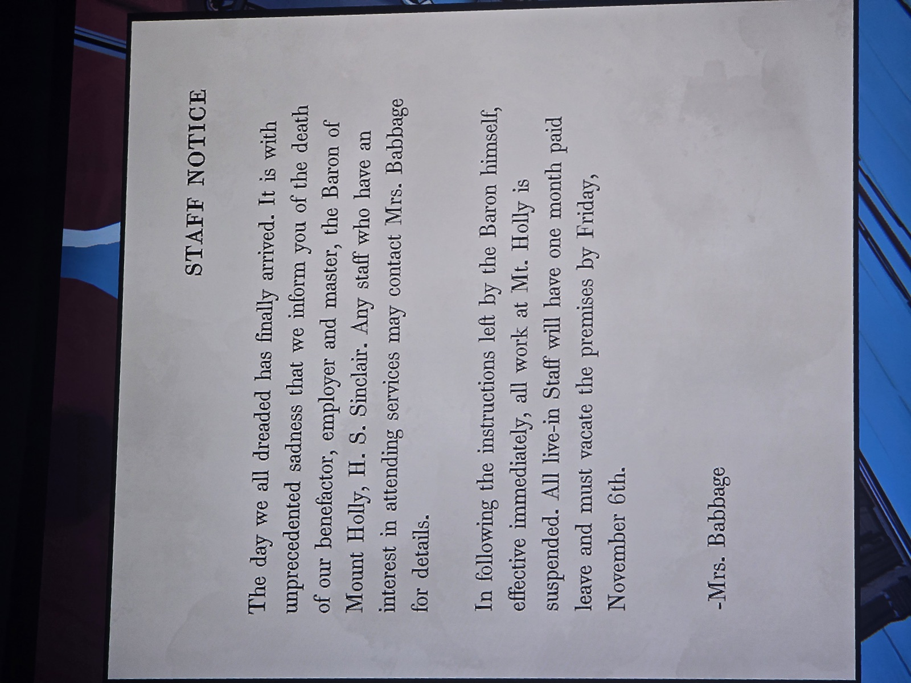

ОБЪЯВЛЕНИЕ ДЛЯ ПЕРСОНАЛА
С беспрецедентной печалью сообщаем о смерти нашего благодетеля, работодателя и хозяина — барона Маунт-Холли Х. С. Синклера. Желающие посетить похороны — обращайтесь к миссис Бэббидж.
По распоряжению самого барона все работы в Маунт-Холли немедленно приостановлены. Проживающий персонал получает месяц оплачиваемого отпуска и должен **покинуть поместье до пятницы, 6 ноября**.
— миссис Бэббидж

*Заметка: 6.11.1993 — пятница, на следующий день (7.11) приезжает Саймон (день 1). Комната не записана.*

## Photos / Фото

