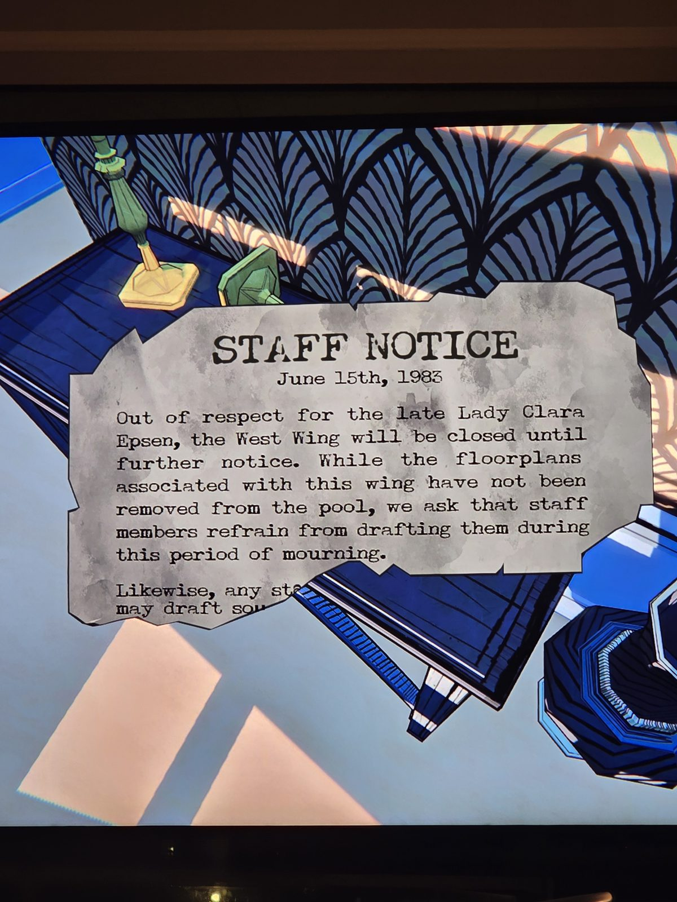

ОБЪЯВЛЕНИЕ ДЛЯ ПЕРСОНАЛА — 15 июня 1983
Из уважения к покойной леди Кларе Эпсен Западное крыло закрыто до особого распоряжения. Чертежи крыла не убраны из набора, но персонал просят не выбирать их в период траура. (Конец текста не виден.)

## Photos / Фото

