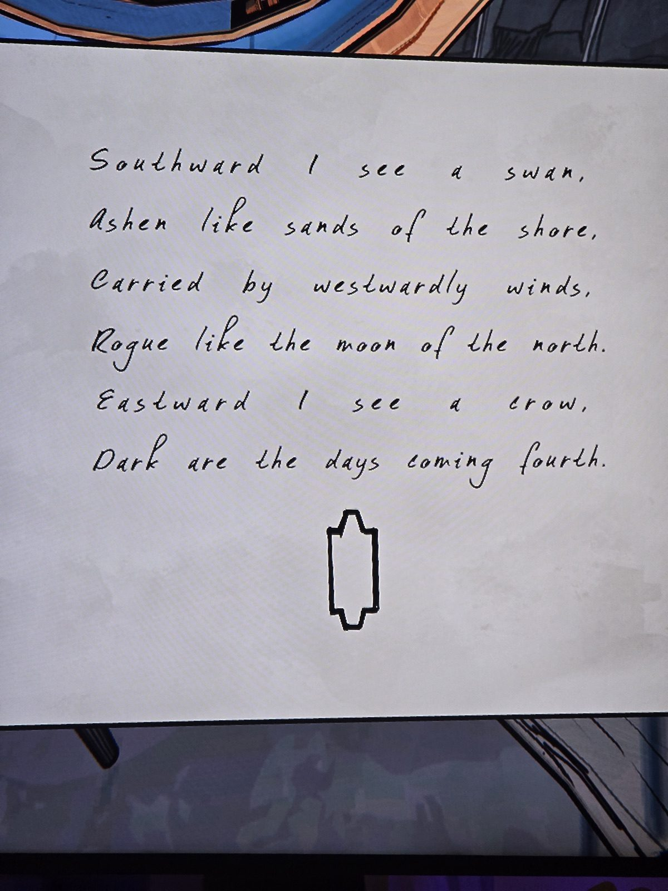

На юге вижу лебедя,
пепельного, как пески берега,
несомого западными ветрами,
беспутного, как луна севера.
На востоке вижу ворону —
темны грядущие дни («fourth» — так в оригинале).
Внизу — **вытянутый шестиугольник** (ядро сигила Orinda Aries).
*Заметка: похоже на описание сигила: направления/ветра → лучи, лебедь/ворона → цвета (белый/чёрный). Не решено. Комната не записана.*

## Photos / Фото

