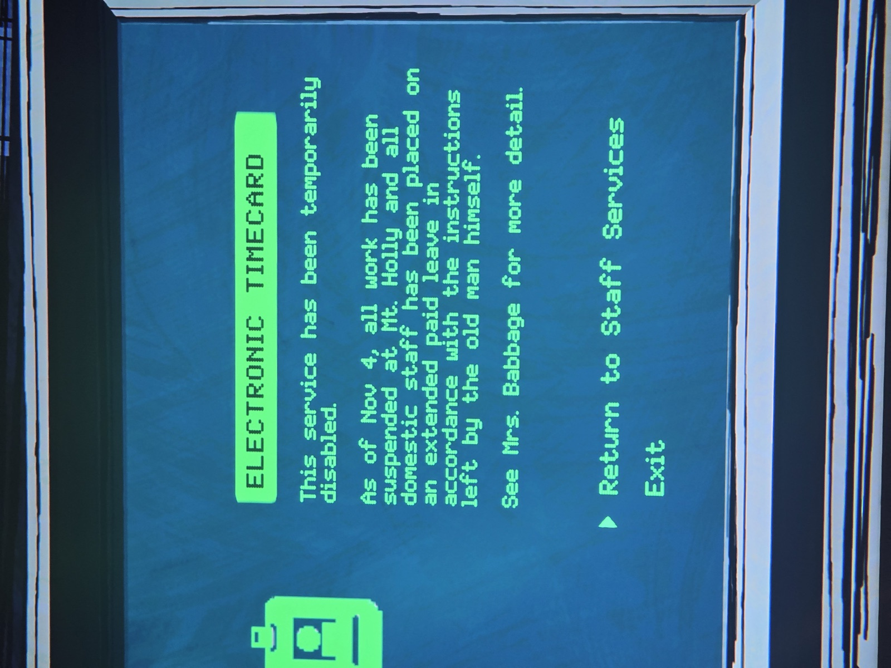
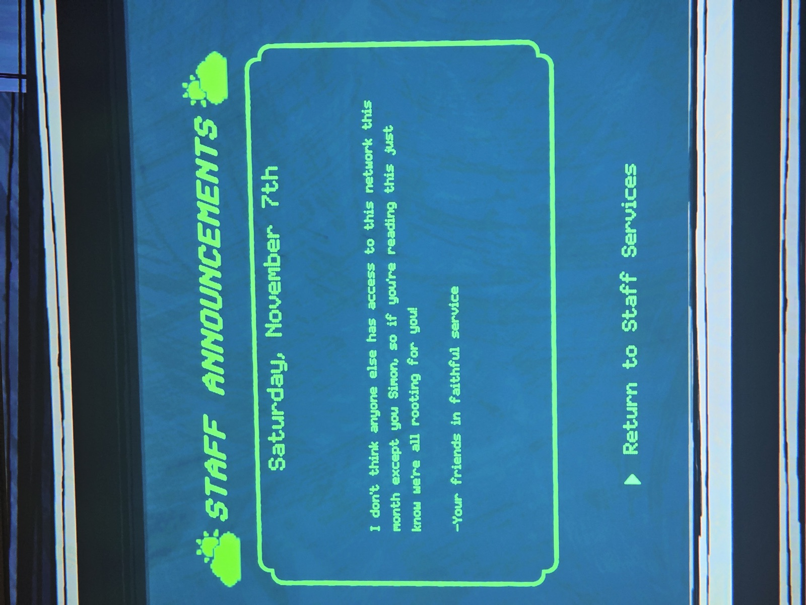
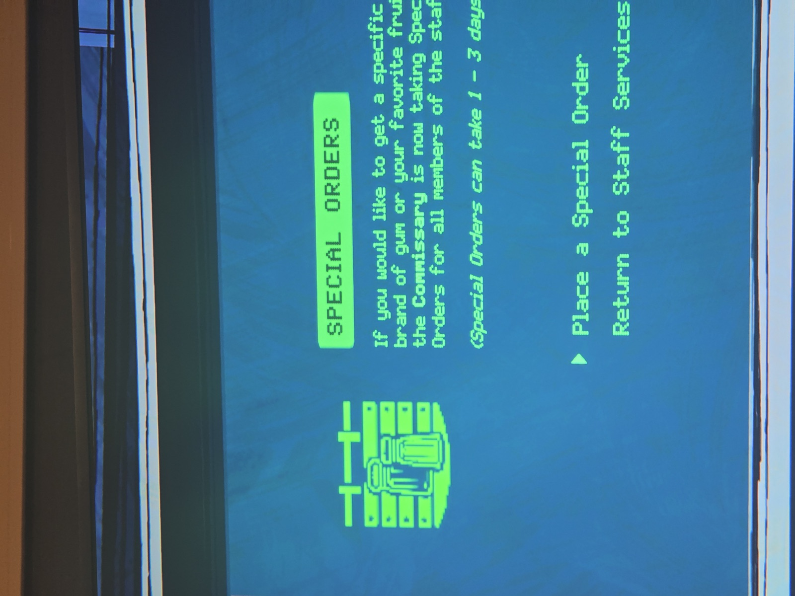

Экраны терминала — раздел **Staff Services**:
1. **Электронный табель** отключён: с 4 ноября все работы приостановлены, персонал в оплачиваемом отпуске «по указанию самого старика». Подробности — у миссис Бэббидж.
2. **Объявления, суббота 7 ноября:** «Думаю, в этом месяце доступ к сети есть только у тебя, Саймон, — знай, мы все за тебя болеем! — Твои друзья по верной службе».
3. **Спецзаказы:** Commissary принимает спецзаказы (жвачка, любимые фрукты…), выполнение 1–3 дня.

*Заметка: Commissary закрыт с 12 по 16 день (объявление на доске у картинок 9.5). Терминал — какой из (Security/Office/Laboratory/Shelter) — не записано.*

## Photos / Фото

