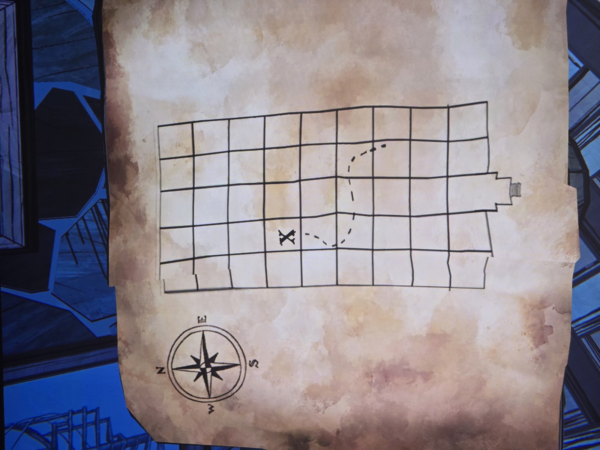

Old parchment map with a compass rose (N/E/S/W). Grid 5 columns × 9 rows (the house plan), entrance at the bottom centre.
X — in column 2 (from the west), 4th row from the top (rank 6).
Dashed path from the X going down and east, ending in column 4, 3rd row from the bottom (rank 3).

## Photos / Фото

