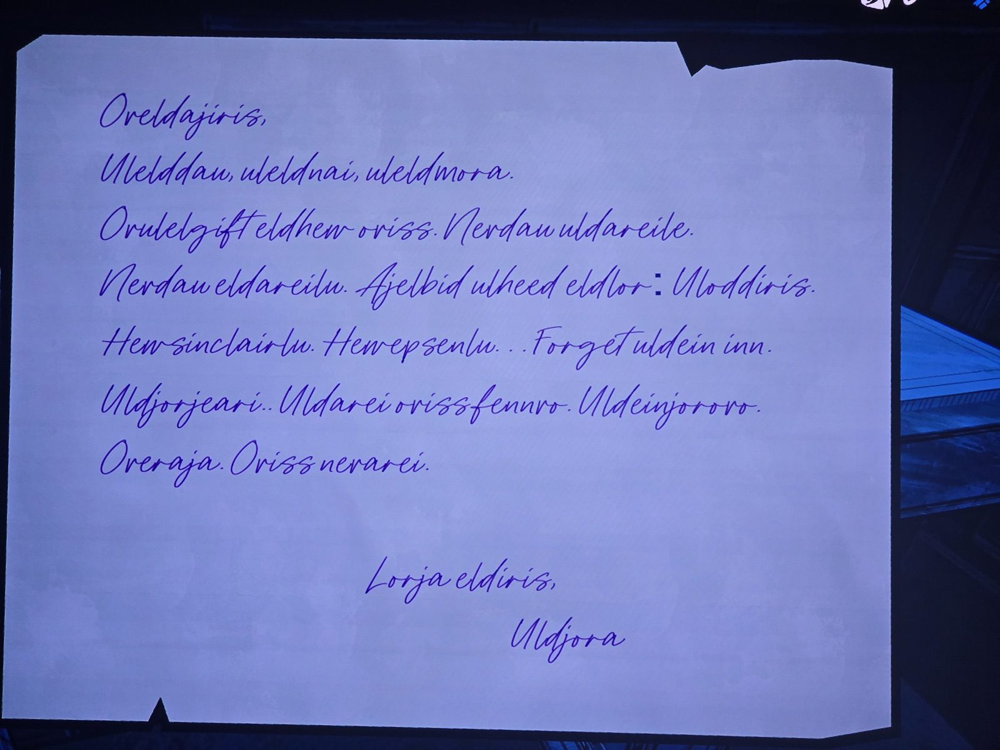

Письмо на **незнакомом языке** (синие чернила), подпись **Uldjora**.
Узнаваемые кусочки: **sinclair**, **epsen** («Hew sinclairlu. Hew epsenlu» — про Синклеров и Эпсенов), **oriss** (Орис), **fenn** (orissfennvo), **mora**, «Forget» — английское слово. Окончание «Nerarei» похоже на подпись Герберта **«Ovinn Nevarei»**.
*Не переведено. Возможно, это тот же язык, что и «Ovinn Nevarei» (Room 46). Комната не записана.*

## Photos / Фото

