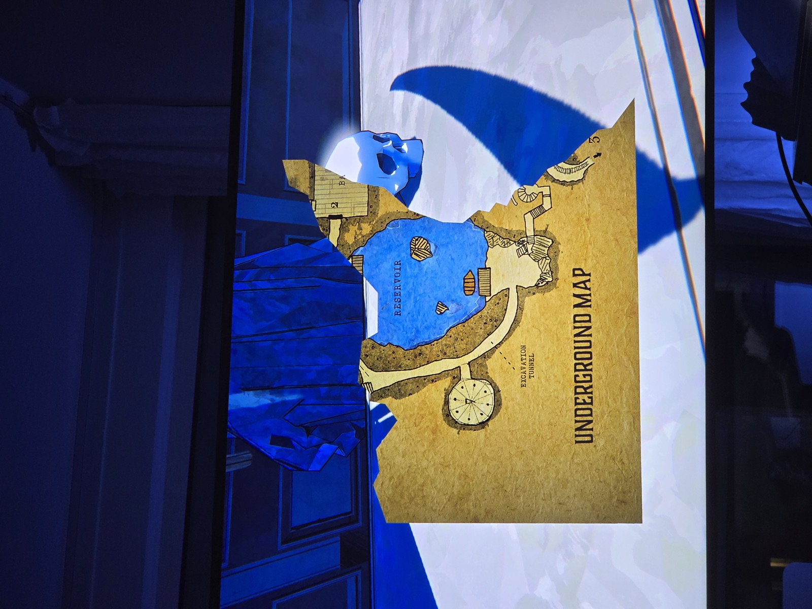
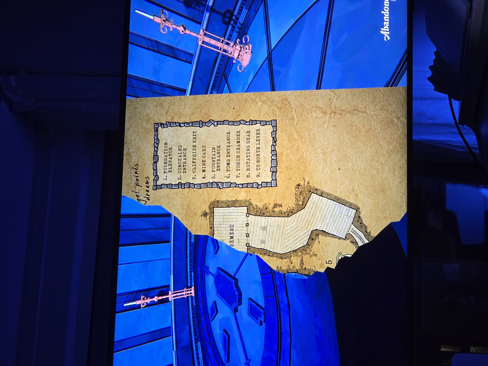
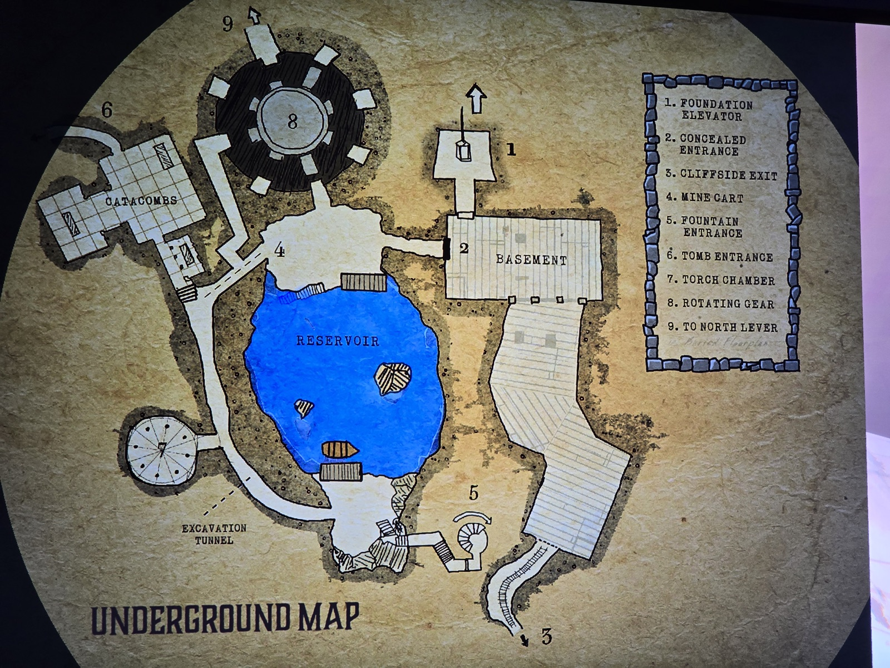

**Карта подземелья** (два обрывка). На первом — резервуар (подземное озеро с островками и лодкой), круглый зал «7», «раскопочный туннель», кусок подвала (BASEMENT) с меткой 2, стрелка 3. На втором — подвал, метка 5 и надпись от руки «[An]gel points … dreams» («ангел указывает … мечты»).

Легенда:
1. Лифт Foundation
2. Скрытый вход
3. Выход на утёс
4. Вагонетка
5. Вход через фонтан
6. Вход в склеп (Tomb)
7. Зал факелов
8. Вращающаяся шестерня
9. К северному рычагу

*Заметка: «Angel points…» — ср. Angel Tower на карте Реддингтона и «ангела» на витраже I в Chapel. Второй обрывок найден в комнате с подписью «Abandon[ed …]» (на полу — циферблат); первый — не подписан. Полной карты ещё нет.*

**Фото 03 — карта целиком:** лифт Foundation (1) → подвал; скрытый вход (2) — дверь на западной стороне подвала; от подвала на юг длинный туннель к выходу на утёс (3). В центре резервуар с двумя островками, лодкой и причалами на севере и юге. К югу от него спиральная лестница — вход через фонтан (5). На западе катакомбы, из них вход в склеп (6). Вагонетка (4) едет от катакомб к резервуару. К западу от резервуара, у раскопочного туннеля, — круглый зал факелов (7). На севере большой круглый зал с шестернёй (8), из него путь к северному рычагу (9). Под легендой бледная надпись: **«Buried Floorplan»** («погребённый план»).

## Photos / Фото

