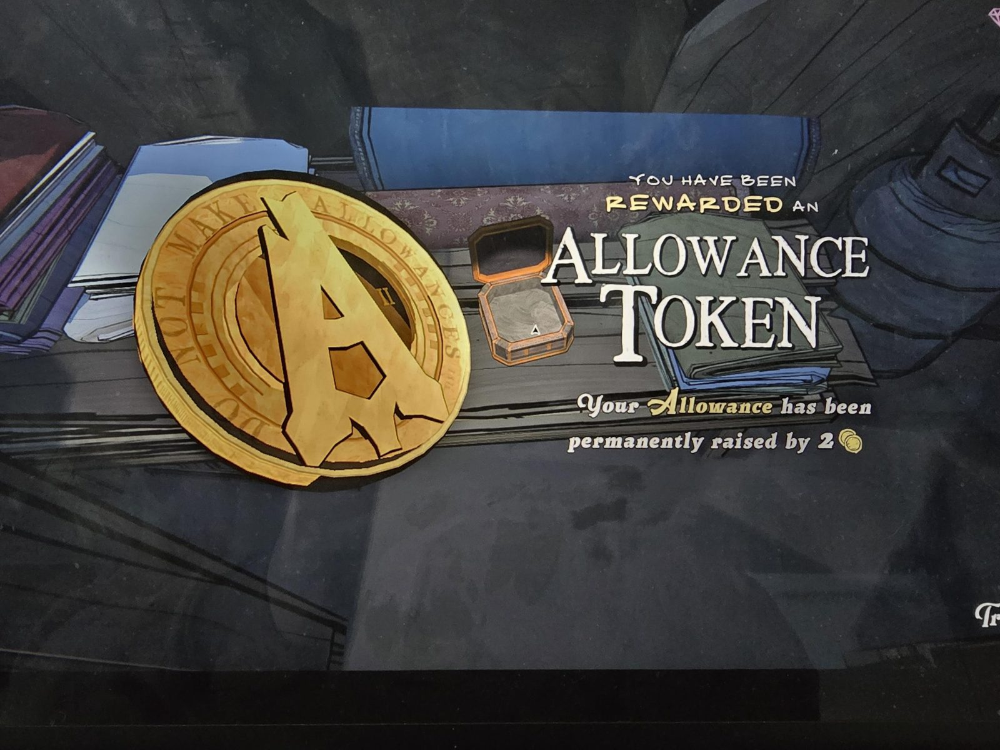

# Жетон надбавки (Allowance Token)
Золотая монета с буквой «A», на ободке надпись вроде «DO NOT MAKE ALLOWANCES».

«Вы получили **жетон надбавки**. Ваше содержание (allowance) **навсегда увеличено на 2 монеты** (🪙).»

## Заметка
- Лежит **внутри каждой коробки Mora Jai**. Получена из [Mora Jai в Trading Post](../../puzzles/mora-jai/trading-post/ru.md).
- Эффект постоянный: +2 монеты к ежедневному содержанию.

## Photos / Фото

