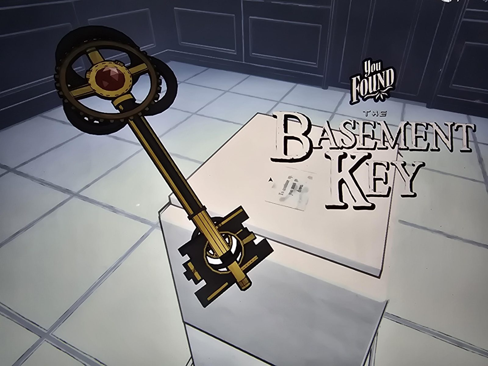

# Ключ от подвала (Basement Key)
Золотой ключ с красным камнем и шестерёнками в головке. На экране находки описания эффекта нет; назначение пока неизвестно (название подсказывает дверь в подвал).

Найден в [Antechamber](../../rooms/antechamber/solutions.md): лежал на белом постаменте рядом с запиской [«To continue up, you must go down»](../../rooms/antechamber/docs/pedestal-note-go-down/ru.md).

## Photos / Фото

