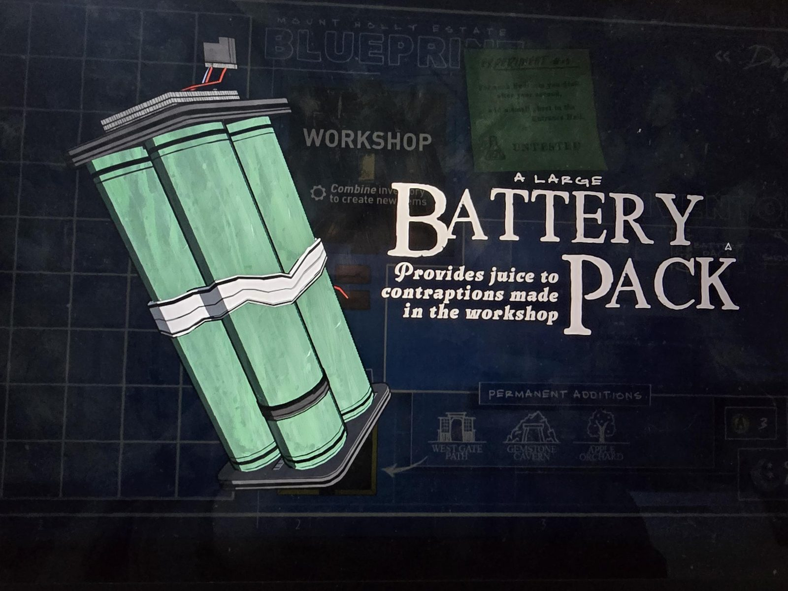

# Батарейный блок (Battery Pack)
Большой блок из зелёных аккумуляторов с проводами.

«Большой **батарейный блок**. Даёт «сок» (питание) устройствам, сделанным в мастерской.»

## Заметка
- Связан с [Workshop](../../rooms/workshop/open-questions.md): на экране у карточки Workshop надпись «Combine inventory to create new items» (там из предметов собирают новые).

## Photos / Фото

