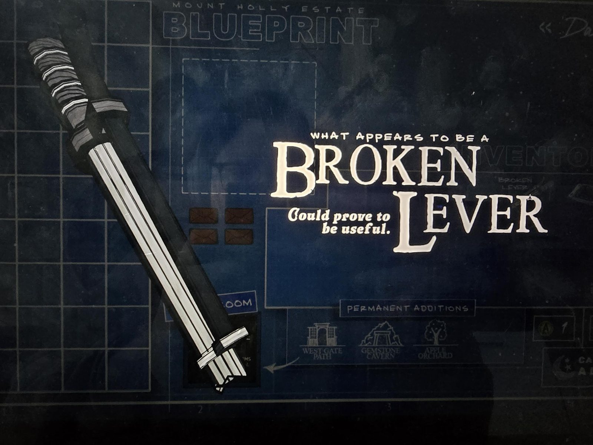

# Сломанный рычаг (Broken Lever)
Предмет инвентаря: рукоять с обмоткой и металлический стержень.

«Похоже, это **сломанный рычаг**. Может оказаться полезным.»

## Заметка
- Где найден: не указано.
- Он нужен для **рычага Antechamber в [Greenhouse](../../rooms/greenhouse/solutions.md)** (тот не работает без него).
- Догадка: может подходить к рычагам, которые в особняке «отсутствуют», например западный/восточный рычаги Antechamber, см. [Office](../../rooms/office/solutions.md).
- На фоне экрана чертежа в «Permanent Additions» значатся West Gate Path, Gemstone Cavern и Apple Orchard.
- Нужен также для игрового автомата в [Casino](../../rooms/casino/solutions.md); входит в рецепт [Power Hammer](../../rooms/workshop/docs/recipe-power-hammer/ru.md).

## Photos / Фото

