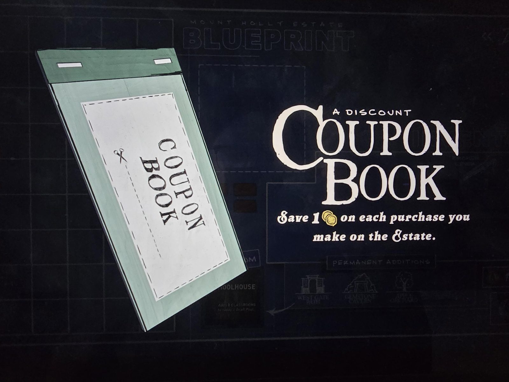

# Книжка купонов (Coupon Book)
Предмет инвентаря: зелёная книжка с отрывными купонами.

«**Книжка купонов** со скидкой: экономь **1 монету** (🪙) на каждой покупке, которую делаешь в поместье.»

## Заметка
- Где найдена: не указано (на фоне чертежа в этот момент предлагалась комната Schoolhouse).

## Photos / Фото

