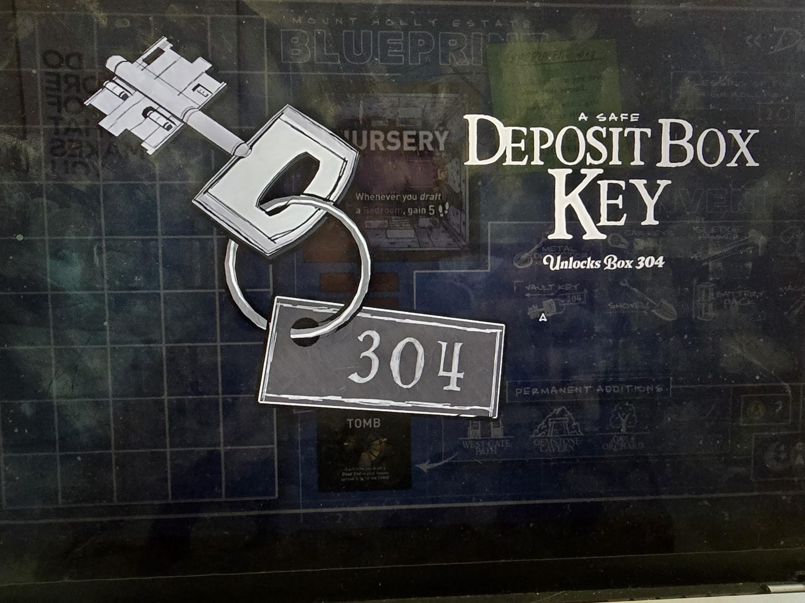

# Ключ от депозитной ячейки (Deposit Box Key)
Ключ на кольце с жетоном **304**.

«**Ключ от банковской ячейки.** Открывает ячейку **304**.»

## Заметка
- Открывает ячейку 304 в [Vault](../../rooms/vault/solutions.md): внутри паспорт ([документ](../../rooms/vault/docs/passport-jean-ribbon/ru.md)).

## Photos / Фото

