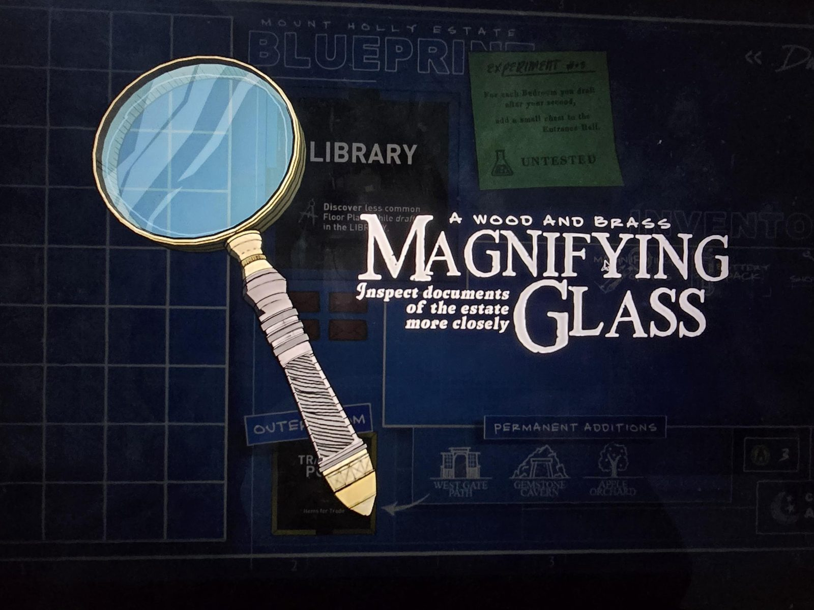

# Лупа (Magnifying Glass)
Лупа из дерева и латуни.

«**Лупа** из дерева и латуни. Позволяет **рассматривать документы поместья ближе**.»

## Заметка
- Нужна для мелких надписей на документах и картинках, например в [Darkroom](../../rooms/darkroom/open-questions.md) (надпись на дереве, письмо).
- На фоне чертежа: карточка Library («Discover less common Floor Plans while drafting in the LIBRARY»).

## Photos / Фото

