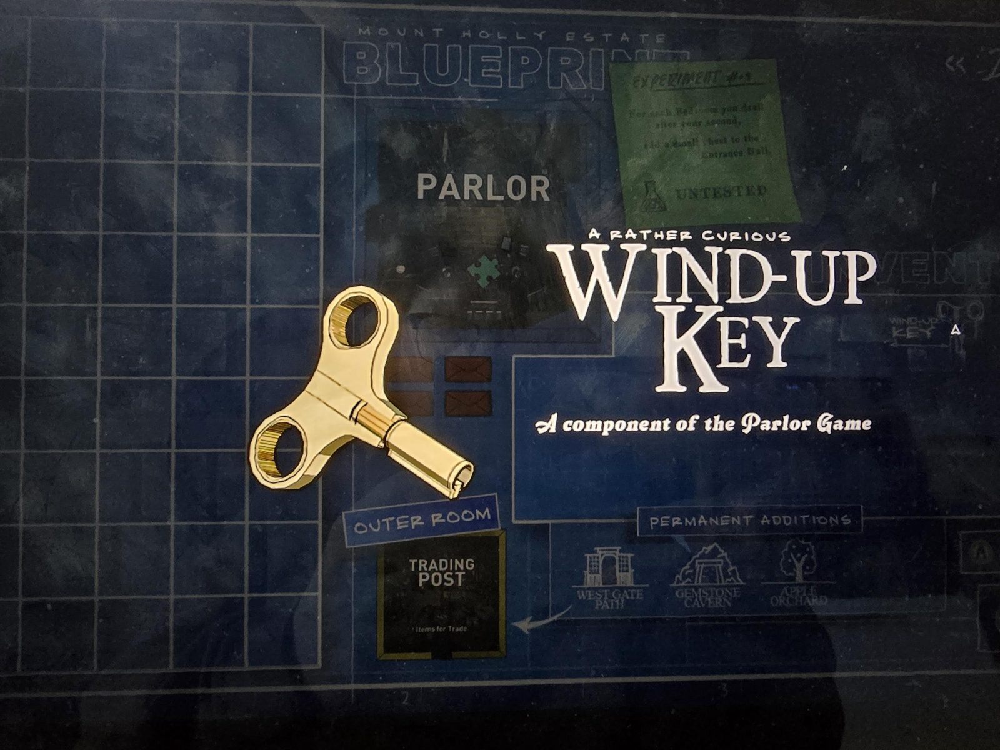

# Заводной ключ (Wind-Up Key)
Золотистый ключ с двумя кольцами-ручками, как у часового механизма.

«Довольно любопытный **заводной ключ**. Деталь **игры в Parlor** (Parlor Game).»

## Заметка
- Где найден: не указано. На экране чертежа в плане была [Parlor](../../rooms/parlor/open-questions.md) и внешняя комната [Trading Post](../../rooms/trading-post/solutions.md) («Items for Trade»).
- Игра в Parlor: что это и какие ещё детали нужны, пока неизвестно.

## Photos / Фото

