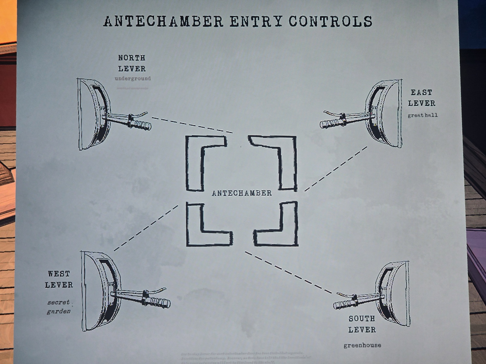

Схема **рычагов Antechamber** — каждый открывает одну из 4 дверей:
| Рычаг | Где |
|---|---|
| Северный | **под землёй** (карта подземелья, п. 9 «To North Lever» — через зал шестерни) |
| Восточный | Great Hall |
| Западный | Secret Garden |
| Южный | Greenhouse (сломан — записка в Office) |
Мелкий текст внизу почти не читается: «резервные рычаги каждой двери установлены отдельно… их расположение персоналу не раскрывается».

*Где найдена — не записано. Ср. записку «To continue up, you must go down».*

## Photos / Фото

