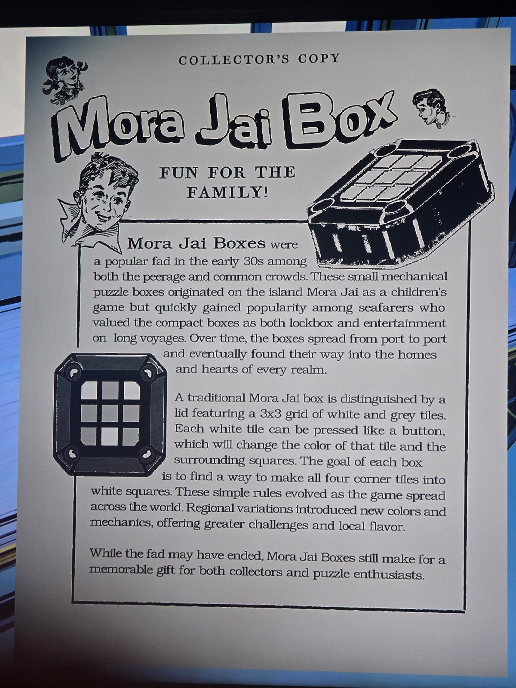

Листовка «Шкатулка Мора Джай — веселье для всей семьи!» (коллекционная копия).
Мода начала 30-х, родом с острова **Мора Джай** (детская игра, потом у моряков — как шкатулка-замок и развлечение).
**Традиционная** шкатулка: сетка 3×3 из **белых и серых** плиток. Белая плитка — кнопка: меняет цвет себя и соседей. **Цель — сделать все 4 угловые плитки белыми.** Региональные варианты добавили новые цвета и механики.
*Заметка: подтверждает правило белой плитки. Цель для «цветных» шкатулок — цвет символа в углах (см. README). Комната не записана.*

## Photos / Фото

